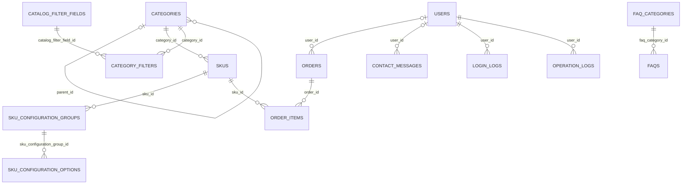

# 接手 Sinower 网站：功能、技术与设计取舍

> 面向第一次接手 Ruby on Rails 网站的维护者。
>
> 核对日期为 2026 年 11 月 20 日。依据当前工作区代码，包括尚未提交的功能。生产服务、线上数据库和云账户的实时状态没有在本次写作中核验。全文的“当前实现”专指这份代码。
>
> 本书目标为十万字。当前文件是持续编写中的初稿，实际字数见末尾统计，尚不能视为十万字完稿。附录的源码索引和表字段清单用于查阅，不计入正文中文汉字数。

## 怎样读这本书

先读第一至第七章，建立浏览器、Rails、数据库之间的关系。随后沿着“分类—商品—筛选—选配—询价”阅读。账户、内容、运营与部署可以在需要时回查。每章把已经存在的实现与可选改进分开，并给出进一步提问。问题的用途是要求开发者解释证据和代价，不能直接当成必须全部实施的需求。

第一次阅读时，不必背下所有类名。先能回答三个问题：用户点了什么，程序读写了什么，失败时用户和数据会处于什么状态。能描述这条路径后，再研究索引、事务与缓存。

## 阅读目录

- [第一章 网站在经营什么业务](#第一章-网站在经营什么业务)
- [第二章 从浏览器请求到页面响应](#第二章-从浏览器请求到页面响应)
- [第三章 MVC 与项目目录](#第三章-mvc-与项目目录)
- [第四章 Ruby、Rails 与依赖版本](#第四章-ruby、rails-与依赖版本)
- [第五章 数据库、表、行和主键](#第五章-数据库、表、行和主键)
- [第六章 一对多、多对多和自关联](#第六章-一对多、多对多和自关联)
- [第七章 模型校验、数据库约束和事务](#第七章-模型校验、数据库约束和事务)
- [第八章 七大频道与分类树](#第八章-七大频道与分类树)
- [第九章 slug 与 category_kind](#第九章-slug-与-category_kind)
- [第十章 隐藏、上架与统一可见性](#第十章-隐藏、上架与统一可见性)
- [第十一章 SKU 的含义与边界](#第十一章-sku-的含义与边界)
- [第十二章 商品规格与 JSONB](#第十二章-商品规格与-jsonb)
- [第十三章 卡片参数与详细特点](#第十三章-卡片参数与详细特点)
- [第十四章 图片附件与缩略图](#第十四章-图片附件与缩略图)
- [第十五章 富文本与文章内容](#第十五章-富文本与文章内容)
- [第十六章 名称搜索与分页](#第十六章-名称搜索与分页)
- [第十七章 后台筛选字段库](#第十七章-后台筛选字段库)
- [第十八章 分类如何选择前台筛选项](#第十八章-分类如何选择前台筛选项)
- [第十九章 JSONB 值提取与单位](#第十九章-jsonb-值提取与单位)
- [第二十章 多选与范围到底如何匹配](#第二十章-多选与范围到底如何匹配)
- [第二十一章 筛选数量与前台状态](#第二十一章-筛选数量与前台状态)
- [第二十二章 SKU 独有的配置组与选项](#第二十二章-sku-独有的配置组与选项)
- [第二十三章 选配界面与浏览器计算](#第二十三章-选配界面与浏览器计算)
- [第二十四章 询价清单与会话](#第二十四章-询价清单与会话)
- [第二十五章 询价单、明细与配置快照](#第二十五章-询价单、明细与配置快照)
- [第二十六章 保存过程中的一致性问题](#第二十六章-保存过程中的一致性问题)
- [第二十七章 注册、登录与 Devise](#第二十七章-注册、登录与-devise)
- [第二十八章 管理权限与角色](#第二十八章-管理权限与角色)
- [第二十九章 经销商申请与个人门户](#第二十九章-经销商申请与个人门户)
- [第三十章 联系留言与邮件通知](#第三十章-联系留言与邮件通知)
- [第三十一章 博客、发布状态和阅读数](#第三十一章-博客、发布状态和阅读数)
- [第三十二章 FAQ 与分类内容](#第三十二章-faq-与分类内容)
- [第三十三章 多语言不是自动翻译](#第三十三章-多语言不是自动翻译)
- [第三十四章 站点设置与内容来源](#第三十四章-站点设置与内容来源)
- [第三十五章 robots、站点地图与 SEO](#第三十五章-robots、站点地图与-seo)
- [第三十六章 访客统计与地理信息](#第三十六章-访客统计与地理信息)
- [第三十七章 登录日志与操作审计](#第三十七章-登录日志与操作审计)
- [第三十八章 缓存、失效和任务](#第三十八章-缓存、失效和任务)
- [第三十九章 ZIP 导入导出与安全回滚](#第三十九章-zip-导入导出与安全回滚)
- [第四十章 卡片参数 CSV 上传](#第四十章-卡片参数-csv-上传)
- [第四十一章 PostgreSQL 与本地迁移](#第四十一章-postgresql-与本地迁移)
- [第四十二章 部署文件与真实部署](#第四十二章-部署文件与真实部署)
- [第四十三章 限流、验证码与隐私](#第四十三章-限流、验证码与隐私)
- [第四十四章 测试应该证明什么](#第四十四章-测试应该证明什么)
- [第四十五章 用日志排查故障](#第四十五章-用日志排查故障)
- [第四十六章 备份必须包含什么](#第四十六章-备份必须包含什么)
- [第四十七章 哪些设计值得改，怎样排序](#第四十七章-哪些设计值得改，怎样排序)
- [第四十八章 新手怎样向 AI 提问](#第四十八章-新手怎样向-ai-提问)
- [第四十九章 三十天接手练习](#第四十九章-三十天接手练习)
- [第五十章 把“更好”写成比较条件](#第五十章-把“更好”写成比较条件)
- [第五十一章 首页推荐、工厂页与静态宣传内容](#第五十一章-首页推荐、工厂页与静态宣传内容)
- [第五十二章 导航、面包屑与页面上下文](#第五十二章-导航、面包屑与页面上下文)
- [第五十三章 Tailwind、Propshaft 与图片性能](#第五十三章-tailwind、propshaft-与图片性能)
- [第五十四章 Alpine 与 Stimulus 如何共存](#第五十四章-alpine-与-stimulus-如何共存)
- [第五十五章 删除商品为什么会牵连多处](#第五十五章-删除商品为什么会牵连多处)
- [第五十六章 用户输入、转义与文件上传](#第五十六章-用户输入、转义与文件上传)
- [第五十七章 时间、货币与地域](#第五十七章-时间、货币与地域)
- [第五十八章 让后台错误信息真正可操作](#第五十八章-让后台错误信息真正可操作)
- [第五十九章 业务数据与分析数据的界限](#第五十九章-业务数据与分析数据的界限)
- [第六十章 一份可交给开发者的需求应有什么](#第六十章-一份可交给开发者的需求应有什么)

# 第一部分：建立网站的整体认识

## 第一章 网站在经营什么业务

当前网站围绕厨房设备展开，提供企业介绍、产品目录、型号详情、文章、FAQ、联系留言、经销商查询和管理后台。询价清单会保存客户需求及选配组合，订单状态主要表示待处理和已回复。接手者应把一次客户询问作为完整业务事件来理解。

客户寻找冰箱时，先通过大类和子类缩小范围，再看容量、电压等条件，进入详情页选择台面和背板，最后把需求交给销售。这条路径穿过多个页面和数据库表。只检查首页是否漂亮，无法知道客户需求是否可靠地保存。

当前代码没有形成在线收款、库存预占、物流发货、退款结算的完整交易流程。如果未来增加付款，必须重新定义订单金额、币种、税费、付款状态和重复回调处理。不能因为模型叫 Order，就假定它已经具备商城订单的全部语义。

**技术入口。** 查看 `config/routes.rb` 与 `app/controllers/orders_controller.rb`，确认公开访问入口和提交字段。

**方案比较。** 展示询盘站的开发和维护负担通常低于完整交易站，适合需要人工报价的设备业务。完整商城适合价格、运费和库存可被确定的业务。哪一个更好，应由报价流程决定。

**深入提问。** 客户提交后由谁处理？多久必须回复？是否需要销售负责人和处理备注？一条需求代表采购意向还是已经确认的合同？怎样证明没有漏单？

## 第二章 从浏览器请求到页面响应

输入网址后，浏览器向服务器发请求。Rails 根据路径和请求方法选择控制器动作。动作读取参数、检查权限、查询模型，再渲染 ERB 模板。浏览器拿到 HTML、CSS 和 JavaScript 后展示页面。

以分类页为例，网址可能带 `kind=refrigeration`、分类标识和筛选条件。控制器决定候选商品范围，筛选服务生成查询，Kaminari 分页，模板循环输出商品卡片。这些步骤发生在服务端，浏览器只显示最终结果并提供下一次输入。

同一个地址的 GET 和 POST 可以承担不同职责。GET 联系页显示表单，POST 联系页尝试保存留言。学习路由时，应同时记录方法、路径、动作和是否写数据。只记录网址会遗漏真正的业务变化。

**替代方案。** 可以让 Rails 提供 JSON 接口、React 或 Vue 绘制页面。这样适合复杂客户端状态，但增加接口契约、前端构建和双端校验成本。当前页面以内容、表单和商品目录为主，服务端渲染是可以成立的选择。

**练习。** 在浏览器开发者工具打开 Network，访问分类页，找出文档请求、图片请求和询价清单请求。分别观察响应类型。

**深入提问。** 一次点击触发几次请求？哪些请求可以重试？GET 请求里是否藏着写操作？网络慢时页面能否保留用户输入？

## 第三章 MVC 与项目目录

Model 处理数据关系和规则，Controller 协调请求，View 输出页面。项目的 `app/models`、`app/controllers`、`app/views` 对应这些职责。数据库并不住在模型文件里，模型通过 Active Record 连接数据库。

Sku 模型说明商品属于分类，也定义图片、富文本和可见性。分类控制器决定查询哪个集合，商品卡片模板决定名称、SKU 代码和卡片参数的排版。修改显示文字通常先找视图，修改商品是否允许归类则先找模型。

服务对象放在 `app/services`。当前筛选解析、JSONB 值提取、目录迁移和卡片参数导入都采用服务对象。它们适合封装有明确输入输出的复杂过程，而非把每个三行方法都拆成文件。

**方案比较。** 所有逻辑塞进控制器容易起步，随后会让不同入口的规则分叉。所有逻辑放模型又可能形成过大的模型。较合理的边界是模型维护核心有效性，服务完成跨记录过程，视图专注展示。

**练习。** 从 `SkusController#show` 顺着 `@sku.localized_name` 找到模型方法，再找到页面输出。

**深入提问。** CSV 导入是否经过与后台同样的模型校验？某条业务规则能否被另一个控制器绕过？一个服务的返回值是否足够清楚？

## 第四章 Ruby、Rails 与依赖版本

Gemfile 声明 Ruby 与依赖，Gemfile.lock 固定解析结果。项目声明 Ruby 3.4.9、Rails 8.1.3。pg 负责连接 PostgreSQL，Devise 负责账户认证，Kaminari 负责分页，rubyzip 和 csv 用于数据包。

依赖不是安装后永远不管的零件。版本升级可能改变参数处理、默认行为或安全限制。先理解依赖负责哪一层，再决定升级顺序。更新 Rails 与数据库版本通常应分别验证，否则出现问题不容易定位来源。

`bundle check` 只是检查依赖是否满足，不能证明服务能启动、数据库能连接或页面能工作。相同地，Gemfile 里出现某个库，只能证明项目声明依赖，是否在实际执行路径使用还要继续检查。

**方案比较。** 全部追最新版本可能增加兼容工作，长期完全冻结也积累维护风险。维护者应保留可重复构建的锁文件，定期审查变更，并优先处理已确认影响本项目的问题。

**深入提问。** 目前谁负责升级？哪些依赖只在开发环境使用？怎样确认一项升级没有改变价格或筛选语义？旧版本能否重新部署？

## 第五章 数据库、表、行和主键

表把同类记录放在一起，列定义字段，一行表示一件具体对象。categories 保存分类，skus 保存型号。id 是内部主键，用来稳定指向某条记录。name 可以改，数据库关联通常继续使用 id。

例如一件商品的 category_id 为 15，表示它关联分类 id 为 15 的记录。它没有复制分类的全部名称与介绍。分类改名后，商品通过同一关联获得新名称。这减少重复，却意味着显示依赖关联记录仍然存在。

主键和业务编码不同。sku_code 是业务型号，slug 是网址标识，它们具有业务含义。对业务唯一性，应同时考虑模型校验和数据库唯一约束。仅在 Rails 保存前查重，不能完全挡住两个并发请求同时通过检查。

**方案比较。** 整数主键便于人工排查、索引紧凑。UUID 适合跨系统生成标识或分布式合并，但更长，也不能替代权限检查。当前独立网站没有仅凭“更现代”就更换全部主键的理由。

**练习。** 用只读 SQL 查一件商品的 id、sku_code、category_id，然后查对应分类。

**深入提问。** 删除分类时商品该怎样处理？业务型号是否可能改名或重复？哪个字段真的需要跨系统稳定？

## 第六章 一对多、多对多和自关联

一个分类可有多件商品，一件商品当前只属于一个分类，这是“一对多”。Rails 在商品模型写 `belongs_to :category`，在分类模型写 `has_many :skus`。外键落在多的一侧，即 skus.category_id。

分类的父子关系属于自关联。categories.parent_id 指向同一张表的 id。一个类既当父类又当子类，根分类的 parent_id 为空。这里没有单独的“一级分类表”“二级分类表”。

一个分类可以选择多个筛选字段，一个筛选字段也可用于多个分类，构成多对多。项目用 category_filters 中间表连接双方。中间表还保存启用状态和顺序，因此它是一项有业务属性的关系。

**方案比较。** 把多个外键写进逗号字符串不利于约束和连接查询。数组外键能表达列表，但数据库参照完整性和关系级属性较难处理。已有启用、顺序要求时，中间表更直接。

**深入提问。** 一个 SKU 是否真的只能属于一个分类？若要跨类推荐，应新增推荐关系还是改变商品的主分类？关系被删除与对象被删除应有何区别？

## 第七章 模型校验、数据库约束和事务

模型校验提供友好的错误提示，数据库约束保护最终写入状态。`validates` 不会自动生成数据库约束。外键、唯一索引、非空和 check constraint 分别解决不同问题。

事务把多次数据库操作组成一个整体。目录导入失败时，前面已经更新的分类应一起回滚。选配组和选项一起保存时，也应避免只保存一半。事务内的网络请求、邮件和对象存储操作则不会因为数据库回滚自动撤销。

“抛异常”和“返回 false”也不同。save! 失败会抛异常，save 通常返回 false。rescue 的范围太大，可能把真正的程序错误包装成普通输入错误。阅读保存路径时，应标出成功条件、失败路径和异常传播。

**方案比较。** 单记录简单编辑由模型保存即可。批量导入需要事务和逐行错误信息。跨数据库与文件存储的工作通常需要重试、补偿和状态记录，不能指望单个 SQL 事务包办。

**练习。** 在测试数据库故意给导入文件第二行写错，确认第一行没有被保存。

**深入提问。** 网络超时发生在提交之前还是之后？重试是否重复创建？用户看到失败时数据库是否已经成功？

# 第二部分：分类与商品目录

## 第八章 七大频道与分类树

Category::ROOT_CATEGORIES 定义七个顶级分类标识，涵盖制冷、不锈钢制品、水槽、烹饪设备、食品设备、零售制冷和通风。当前顶级分类校验依赖这份名单，因此新增第八大类需要代码配合。

子类通过 parent_id 延伸。模型检查父分类存在、不能形成环、父分类不能已有商品。商品只能挂叶子分类。这使每个商品归属的目录位置明确，也让叶子类别适合作为同类产品参数的配置位置。

层级在模型上没有固定为三级，但部分页面只写了有限层的展示和预加载。数据库允许更多层，并不证明所有模板都能完整展示。接手者应区分存储能力、查询能力和交互能力。

**方案比较。** 当前邻接表适合层级变化不频繁、树规模有限的目录。物化路径便于查后代，但移动分支要改路径。闭包表让祖先查询明确，却增加维护行数与一致性工作。递归 SQL 可以在邻接表上处理任意深度。

**深入提问。** 七大类真是固定业务规则还是历史页面设计？同类商品的技术参数是否与导航层级一致？移动有商品的分支后，旧链接和统计应怎样变化？

## 第九章 slug 与 category_kind

slug 是网址友好的分类标识，例如 refrigeration。模型可以根据名称生成，随后要求全局唯一及限定字符。顶级 slug 又承担频道标识，已有子项的根分类不允许随意更换它。

category_kind 保存所属根频道。子分类保存时从父分类继承，因此可以直接按频道查找。它是可由祖先关系推导的冗余信息。冗余能降低某些查询复杂度，但必须同步。

当前模型在频道值变化后更新整棵后代分支，包括隐藏分类，操作在保存事务中。缓存还需要清除新旧频道对应的键。若绕过模型直接更新 parent_id，这条同步路径不会执行。

**方案比较。** 可以去掉 category_kind 并用递归查询计算根，减少重复值。也可以保存 root_category_id 并建立外键，避免依赖文字标识。保留现状适合已有路由依赖很多的阶段，但要集中管理树移动。

**练习。** 在测试库移动一个三级分类，分别检查当前分类和孙分类的频道值，再回滚。

**深入提问。** 根改名、根改网址和根合并是同一件事吗？需要永久重定向吗？哪个字段应当成为长期稳定标识？

## 第十章 隐藏、上架与统一可见性

Sku.visible 要求商品为 active，且分类属于 Category.visible。分类可见查询从未隐藏的根开始递归，只走未隐藏的后代。因此上级隐藏会使整条分支退出前台候选范围。

集中 scope 的价值在于列表、搜索、详情和询价入口可以共用同一规则。只在菜单里隐藏链接，直接输入 URL 仍可能访问。可见性应在数据读取处执行，模板再决定如何反馈未找到。

当前实现不是发布审批系统。状态字段支持 active、draft、archived 的界面选项，但应检查模型是否严格限制所有可能字符串。隐藏分类也不等于删除数据，恢复上级后，未单独隐藏的下级可能重新出现。

**方案比较。** 把所有后代 hidden 批量改成 true 会丢失原有局部选择。按祖先计算能保留各节点自身状态，代价是多一次树查询。数据量上升后可考虑缓存有效可见性，但缓存失效必须可靠。

**深入提问。** 下架商品是否应保留说明页？老客户订单中的商品能否继续查看？后台预览与公开页面是否要使用不同权限入口？

## 第十一章 SKU 的含义与边界

当前 Sku 是一个产品型号记录，保存名称、型号代码、分类、状态、价格、规格、图片和富文本特点。项目没有再建立一个 Product 父表来承载所有型号的公共介绍。

这种设计对每种型号拥有独立详情页的外贸目录较容易理解。如果大量型号只在容量或尺寸上不同，公共内容可能重复。此时可以引入产品系列和变体，但需要明确哪些字段继承、哪些可以覆盖。

价格使用 decimal，避免把货币运算简单交给浮点数。主机价格目前缺少独立货币字段，筛选价格的币种来自管理员对筛选字段的配置。这一配置代表运营约定，数据库尚未证明所有商品的币种一致。

**方案比较。** 只有 Sku 的结构简单，公共内容重复较多。Product + Variant 适合有稳定系列关系的商品。组件装配结构更适合工程 BOM，不能因为出现选配就立即改成制造管理系统。

**深入提问。** 型号代码是否唯一且必填？型号换代后是否复用旧编码？价格究竟是标准售价、参考价还是内部采购价？

## 第十二章 商品规格与 JSONB

specifications 现在声明为 PostgreSQL JSONB。已有商品主要使用带多语言 key/value 的数组，读取方法也兼容部分历史对象结构。JSONB 能保存结构化内容，但不会替业务规定容量字段必须是什么名字。

把“容量 500L”自由存成文字解决了快速录入和多类型商品共存的问题。随之而来的是字段名称、大小写、单位和翻译不一致。数据库存储正确与业务语义一致是两层要求。

当前商品模型的 localized_specifications 会按语言取值。筛选值提取则优先选择原始值，避免客户切换语言后筛出不同商品。这也要求翻译内容与原始值不能相互矛盾。

**方案比较。** 固定列有类型和索引优势，但异构属性多时会出现很多空列。JSONB 灵活，规则和索引需要另外设计。属性定义加商品属性值表便于统一规则和统计，加入成本也更高。当前方案更接近对历史 JSONB 的兼容读取。

**深入提问。** 单位是谁规定的？同一个商品有两个矛盾容量值该怎么办？更新翻译是否可能改变技术事实？怎样区分缺失值、零和不适用？

## 第十三章 卡片参数与详细特点

card_parameters_en、zh、it、fr 是最近增加的专门字段，用于集合页卡片中 SKU 代码下的短参数。管理员每行填一项，最多四行，每行最多八十字符。换行、空行和前后空格会被规范化。

卡片参数承担快速比较的职责。standard_features 是详情富文本，承担完整介绍。当前集合页已删除自动从产品特点截取的摘要，卡片的内容来源因此更明确。

代价是信息可能重复维护。例如规格里的容量改成六百升，卡片仍写五百升。当前字段属于人工编辑文案，程序没有自动建立两者对应关系。

**方案比较。** 自动截取特点维护便宜，但内容难以控制。人工卡片字段能突出卖点，却可能过期。更长期的选择是由分类指定要展示的规范属性，再给管理员提供少量补充文案。

**练习。** 修改一个 SKU 的中文卡片参数，检查分类页和搜索结果是否一致，再切换到缺少翻译的语言检查回退。

**深入提问。** 卡片上最能帮助购买决策的三项是什么？卖点与可比较的技术数据是否应采用不同展示方式？

## 第十四章 图片附件与缩略图

商品通过 Active Storage 的 has_many_attached 关联多张图片。附件关系表说明某个文件属于哪条商品记录，blob 表保存文件元信息和存储 key。实际图片文件在本地目录或对象存储中。

模型定义 thumb、medium、large 等 WebP 变体，生产配置使用 vips 处理。附件表另有 position 字段，控制图片次序。产品排序与图片排序是两个不同字段。

删除一张商品图片需要校验它确实属于当前商品。只按全局附件 ID 删除会让一个管理入口操作到别的商品文件。当前后台使用商品关联查找图片，这是应保留的边界。

**方案比较。** 直接把 URL 字符串存商品表容易开始，但文件生命周期、权限和变体要自行管理。Active Storage 提供关联机制，运维仍要备份文件并维护服务配置。数据库备份包含 blob 记录也不等于已经备份图片字节。

**深入提问。** 原图被删但变体仍在时页面会怎样？上传失败是否回滚商品编辑？大批量上传会不会超出请求时间？

## 第十五章 富文本与文章内容

商品特点和博客正文使用 Action Text，正文存在 action_text_rich_texts，依靠 record_type、record_id、name 找回所属记录和语言字段。它解决了格式化正文和嵌入内容的需求。

富文本比普通字符串有更复杂的存储关系。商品表里找不到 standard_features 列，并不表示内容没保存。备份、导入和删除时要同时考虑富文本记录及其中引用的附件。

**方案比较。** 纯文本适合短说明，最容易转移。Markdown 便于版本管理，但业务人员可能不习惯。可视化富文本编辑适合运营录入，HTML 清洗、粘贴质量和图片生命周期仍要检查。

**深入提问。** 复制网页来的样式是否污染布局？正文翻译能否独立审核？删除商品后富文本与嵌入附件如何处理？

# 第三部分：搜索、筛选和选配

## 第十六章 名称搜索与分页

分类控制器与 HomeController 的产品搜索使用数据库 LIKE，查询产品 name 和 sku_code，并用 sanitize_sql_like 处理用户输入中的模式字符。查询条件会与当前分类范围结合。

名称有多语言列，但查询若只搜索 name，客户输入其他语言名称可能找不到。安全地拼接参数与业务上搜得到是两回事。前者保护查询，后者要求检索字段符合客户语言和习惯。

Kaminari 负责分页。筛选必须先在完整候选集合执行，再分页。如果先取二十条再在 Ruby 中判断容量，会漏掉后面本来符合要求的商品。

**方案比较。** LIKE 对小目录简单有效。PostgreSQL 全文、trigram 或外部搜索服务可以支持更复杂匹配，却需要配置分词、同步索引和故障降级。升级前应先采集真实搜索词与零结果情况。

**深入提问。** 搜索型号是否需要精确优先？客户输入单位、同义词或拼写错误时如何响应？排名应该基于什么？

## 第十七章 后台筛选字段库

catalog_filter_fields 保存字段代码、名称、筛选类型、单位和历史规格名称列表。管理员把 Capacity、Volume 等同义写法映射到一个字段。字段代码保存后固定，避免网址参数失去对应关系。

这是目前已经实现的兼容层。它不强制后台新增商品必须按统一属性模板录入。讨论中出现过的“属性定义、叶子分类录入规则、规范值字段”仍属于另一种更完整的方案，不能把它与当前字段库混称为同一个实现。

字段可配置 choice、number、interval、interval_cover、price。类型决定输入控件和 SQL 判断，管理员不能任意上传 SQL 表达式。历史名称和单位通过数据库引用值处理，减少注入风险。

**方案比较。** 名称映射适合已有数据不统一但需要尽快筛选的阶段。规范属性库可以从源头提升一致性，迁移时要处理大量旧值。两者可以先后演进，但要防止永久保留互相矛盾的两份值。

**深入提问。** 一个名字在不同产品中是否可能含义不同？毛重被错写成容量时，名称映射能识别吗？谁批准新的同义词？

## 第十八章 分类如何选择前台筛选项

category_filters 将分类与筛选字段连接，保存 enabled 和 position。数据库对两者组合建立唯一索引，防止同一字段在同一集合页重复配置。

每个大类、中间类和叶子类都可以独立配置。根页可能放电压，制冰机页放日产冰量。当前代码不会自动继承父分类的所有筛选配置，这让页面含义明确，也带来一定重复配置工作。

后台显示有效数据覆盖数。没有可解析数据的筛选不会凭空生成有效选项。覆盖数只是可被当前规则读取的商品数，不能证明该字段填写正确，更不能代表整个分类都适用。

**方案比较。** 自动汇总所有属性省管理员操作，容易让大类页面出现很多无关条件。只显示所有子类共有属性可能过于保守。管理员显式选择提供控制权，未来可增加有清晰适用范围的条件显示。

**深入提问。** 商品只在部分子类有某属性时，使用该筛选是否应排除其他子类？字段何时应显示帮助说明？

## 第十九章 JSONB 值提取与单位

CatalogFilterValues 使用 LATERAL 子查询读取当前商品的规格。数组通过 jsonb_array_elements 展开，历史对象通过 jsonb_each_text 展开，然后根据名称映射找原始值。

数值解析使用限定正则，只接受明确的数字和指定单位。摄氏度符号和部分负号得到兼容处理。单位不符、格式含糊或多个值冲突时，当前实现宁可不把它当作一个可靠数值。

它不会自动把零点五立方米换成五百升。把两个名称映射到容量，并不能自动解决单位转换。管理员定义单位时必须检查商品数据，必要时先整理。

**方案比较。** 查询时解析保留旧数据，但每次查询都有成本。写入时规范化减少读取开销，要求编辑和导入共同使用转换规则。物化数值列或属性值表适合筛选成熟后的高频查询。

**练习。** 对同一字段分别测试 500 L、500 kg、约五百升、空字符串和零，记录哪些会被纳入筛选。

**深入提问。** 无单位数字按什么单位解释？数据冲突要报警还是排除？哪里能看到被解析规则排除的商品清单？

## 第二十章 多选与范围到底如何匹配

同组枚举多选采用 OR，不同筛选组采用 AND。客户选择玻璃门或实心门，同时要求容量五百至六百升，表示满足一种门型并且满足容量范围。

number 类型比较一个商品数值是否落在请求上下限内。interval 比较商品自身的运行区间是否包含客户目标值。interval_cover 要求设备区间完整包含客户请求区间。三种语义不能只用一个“范围”标签概括。

例如设备温度范围为负十八至负十，目标负十五可以匹配。客户要求完整覆盖负十六至负十二也可以匹配；若设备只能到负十五，则无法覆盖全部要求。边界的等号决定恰好满足时应被保留。

**方案比较。** 区间交集适合寻找有任意重叠的资源，设备能力选择通常更需要包含语义。按字符串包含温度既不能正确处理负数，也不能表达工程含义。

**深入提问。** 单边上下限是否允许？客户把最低值填得更高时提示什么？缺失值、false 和零是否被错误地当成空？

## 第二十一章 筛选数量与前台状态

CatalogFilterQuery 解析允许的参数，组合查询，并计算选项数量。结果数来自完整查询，随后才进行分页。枚举的可用数量是在其他组条件下计算，因此同一组的不同选项仍可以继续选择。

已选条件显示为可移除标签，URL 保存条件。无结果时保留标签，用户可以恢复。筛选配置不属于当前分类的字段不会参与查询，这是避免跨集合误用的基本限制。

当前前台采用明确提交的筛选表单，并未实现此前设计稿讨论的完整手机抽屉和即时预览数量。阅读书稿时，应以模板实际结构为准。

**方案比较。** 即时刷新减少点击，但数字输入过程可能不断发请求。提交按钮更可预测。选择方案应结合响应速度、移动屏幕和用户是否要一次填写多项条件。

**深入提问。** 切换分类后哪些条件应保留？返回按钮能否恢复上次选择？数量统计与列表是否使用了完全相同的可见性条件？

## 第二十二章 SKU 独有的配置组与选项

sku_configuration_groups 属于一件 SKU，sku_configuration_options 属于一个组。台面组可有白、黑、灰三项，背板组可有标准板、胡桃木板。客户每组选一个，两组组合形成这一台设备的装配要求。

每项保存多语言名称、model_code、surcharge、顺序、启用状态，并关联图片。币种保存在组上，避免每项重复填币种。当前默认项由排序最靠前的启用选项确定，管理员改变顺序也可能改变默认选择。

加价零表示不加价，空表示请询，二者不能互换。不同币种的加价不能直接算一个数字，当前前端按币种分别合计。主机价没有货币时，显示配置加价比擅自显示含配置总价更清楚。

**方案比较。** SKU 独有组与用户的业务一致，但重复款式会分别维护。共享模板适合大量型号统一维护时使用，必须防止改模板意外改变已发布型号。组合库存模型适合需要单独库存和编码的可销售变体。

**深入提问。** 某台面是否只适配一种背板？某项选配是否会改变交期、尺寸或运费？需要选项互斥和依赖时怎样表达？

## 第二十三章 选配界面与浏览器计算

SkuConfigurator 的 Stimulus 控制器读取每个 radio 的加价，以分为单位合计，并在 output 中更新结果。整数分减少常见的小数显示误差。图片和名称展示具体样式，radio 表示同组只能选一项。

后台使用嵌套表单创建组和选项，JavaScript 动态添加和移除行。隐藏的删除字段告诉 Rails 删除哪些已有选项。直接把行从 DOM 删掉，只会让已有记录没有被提交，未必代表删除。

前端计算提供即时反馈，但保存询价时服务器必须重新读取选项。浏览器可被用户修改，不应把它传来的加价当作可信金额。

**方案比较。** 简单本地相加适合独立选项。若价格依赖组合、数量阶梯或地区，则需要服务端报价接口。纯前端复制整套价格规则会增加双端不一致风险。

**深入提问。** 页面打开后管理员改价，客户提交时采用哪一版？金额需要确认弹窗吗？加价未知的选项应如何合计和表达？

# 第四部分：询价、账户与内容

## 第二十四章 询价清单与会话

清单保存在 Rails session。早期只有 sku_id 与数量，新增选配后，键包含 SKU 与规范排序的选项 ID。相同组合可以累计数量，不同组合分行，这避免同一型号的两种台面被错误合并。

添加时，SkuConfigurationSelection 检查选项格式、归属、启用状态和每组一项。商品卡片直接添加有配置的 SKU 时，服务器返回详情页地址，让客户先完成选择。

会话不是跨设备购物车。Cookie 会话有体积限制，清单键越长、行数越多，越容易触及限制。当前尚未设置成熟的购物车容量和并发编辑规则。

**方案比较。** session 清单实现简单，适合小型询盘。数据库购物车支持持久化、跨设备、较多行和更清楚的并发控制，但要管理匿名身份、过期和登录合并。

**深入提问。** 两个标签页同时添加会不会覆盖？清单里能放多少种组合？登录前后的清单怎样合并？

## 第二十五章 询价单、明细与配置快照

orders 保存联系人、国家、电话、邮箱、留言、状态和可选 user_id。order_items 保存订单、商品、数量及 configuration_snapshot。订单与明细是一对多，让一条询价包含多件商品。

配置快照是保存当时的组名、选项名、型号、币种和加价，放在 JSONB 数组中。管理员后来把黑色台面改名，旧询价仍可说明客户当时选择的内容。

快照与当前商品关联各有用途。关联让系统能跳转到现有商品，快照保存历史事实。当前快照只覆盖选配内容，主机完整名称、基础报价、客户地区和商业条款没有全部成为不可变报价记录。

**方案比较。** 只保存选项 ID 节省重复数据，但删除或改价后历史失真。保存快照增加重复，却有明确的历史含义。正式报价应再设计版本、有效期和确认流程。

**深入提问。** 配置停用后，旧清单要提醒还是自动删除？客户连续点提交会不会产生两个询价？旧询价能否因为商品删除而无法打开？

## 第二十六章 保存过程中的一致性问题

当前提交动作清理不可用清单，构造 Order，并通过关联建立明细后保存。它使用服务器读取的选配记录生成快照，降低信任客户端金额的风险。

仍需认识并发边界。请求开始时检查选项有效，不代表管理员在请求期间不会改它。严格报价需要定义版本或锁定策略。当前站点主要收集意向，因此可以由销售确认，但页面文字应与这种业务性质一致。

重复提交也不由普通事务自动解决。两个请求各自都可以合法提交成功。需要真正防重复时，可以采用客户端生成提交令牌和数据库唯一键，让同一意图只创建一单。

**方案比较。** 禁用按钮改善体验，无法阻止网络重试。服务器幂等键更可靠。数据库行锁适合保护同一记录竞争，不能直接解决全部网络层重试。

**深入提问。** 失败后清单何时清空？价格读取和快照写入是否应该在同一事务？运营能否识别重复询价？

## 第二十七章 注册、登录与 Devise

User 启用 database_authenticatable、registerable、rememberable、validatable 和 lockable。登录使用邮箱和密码，注册支持提交企业信息及经销商申请。

有找回密码模板不代表启用了 recoverable；有邮箱确认模板也不代表启用了 confirmable。读懂认证系统应先看 User 的 Devise 模块，再看路由与页面。

数据库保存密码散列而非直接保存用户填写的密码。登录时需要比较安全散列。管理员一般不应查看原密码，也不应通过给数据库写普通字符串的方式重置密码。

**方案比较。** 成熟认证库减少基础实现成本，自行实现需要处理会话、密码散列、找回、锁定和攻击防护。外部身份服务适合多应用统一登录，但会引入供应商依赖和账号映射。

**深入提问。** 密码恢复是否真的可用？管理员是否需要第二因素？角色变化后现有会话何时失效？

## 第二十八章 管理权限与角色

后台 BaseController 先检查登录，再通过 admin_role? 判断 super_admin、admin 或 editor。部分控制器额外要求 require_super_admin。权限依赖服务端检查，隐藏菜单只是展示层。

User 同时存在 role 字符串和旧 admin 布尔字段。super_admin? 接受旧布尔标记，但 admin_role? 只检查 role 列。两个判断的含义存在差异，维护时应逐入口检查，而不能仅凭“三级权限”概括。

编辑与普通管理员当前模块权限并没有完整细分。如果业务需要让编辑只改文章，必须明确每项动作和资源范围，然后在服务端执行规则。

**方案比较。** 简单角色方法容易理解，但权限分散后难以审计。Policy 类可以按资源和动作集中说明，适合角色增加或同一对象需要不同权限时。可配置权限系统能力强，管理成本也更高。

**深入提问。** 谁能删除用户和订单？谁能上传 CSV？降低角色后是否还能访问已打开的编辑页？怎样测试越权请求？

## 第二十九章 经销商申请与个人门户

经销商并非独立表，企业字段和 dealer_status 保存于 users。管理员批准会设置 role 为 dealer、状态为 approved，并记录时间。申请人也可以进入自己的门户查看申请相关页面。

门户查询通过 current_user.orders 和 current_user.contact_messages 限定归属。使用这种关联查找比先全局 find 再希望模板不泄露数据更直接。超管允许进入门户不意味着自动看到其他经销商全部数据。

经销商资料当前属于一个用户。若企业有多个员工共享询价，需要引入公司、成员关系和公司级权限，不能继续把 company_name 当成真正的企业实体。

**方案比较。** 单用户企业字段适合简单申请。Company + Membership 适合多用户协作、员工离职和企业所有权转移。两种设计没有脱离业务的绝对优劣。

**深入提问。** 审核拒绝后是否允许重新申请？经销商权限撤回与账号封禁有何区别？企业历史订单由谁拥有？

## 第三十章 联系留言与邮件通知

HomeController#create_contact 验证 Turnstile、隐私勾选和字段后保存 ContactMessage，再同步发送通知邮件。邮件失败会记录日志，已保存的留言仍留在数据库。

这个顺序降低邮件服务故障造成留言丢失的风险，但客户看到成功时不意味着管理员已收到邮件。后台未读列表是另一条查看途径。若仅依赖收件箱运营，需要建立通知失败的重试与告警。

当前代码允许在未登录时按填写邮箱关联已有用户。邮箱文字并不能证明提交者拥有该邮箱，所以这种自动归属可能使用户门户出现他人提交的内容。该问题应按业务隐私要求进一步评估。

**方案比较。** 同步发信直接、易调试，但受网络延迟影响。后台队列发信降低响应时间，需要工作进程与失败监控。事务外箱适合要求通知不漏发的系统。

**深入提问。** 邮件失败由谁知道？超时后重发是否重复通知？管理员能否在后台直接回复并留存处理记录？

## 第三十一章 博客、发布状态和阅读数

Post 保存标题、摘要、文章类别、状态、发布时间、阅读数和 SEO 数据，正文通过 Action Text 保存。公开列表只取 published，文章详情增加 views_count。

状态与时间有不同意义。发布状态说明是否公开，发布时间说明排序及计划时点。当前模型的已发布查询没有据此建立完整的定时发布机制。不能仅填未来时间就认为文章会到点自动上线。

每次详情请求递增阅读量不是去重人数。机器人、刷新和同一个人的多次打开都可能计数。它适合粗略热度，不适合直接报告真实读者数。

**方案比较。** 数据库计数简单，但热门文章可能形成频繁写入。分析平台可以提供会话统计，缓存聚合可以降低写压力，二者都需要定义清楚指标口径。

**深入提问。** 发布时间允许未来吗？撤稿后旧链接返回什么？多语言文章是否需要独立发布和审核？

## 第三十二章 FAQ 与分类内容

FAQ 分类和问答分成两张表，问答归属 faq_category_id。分类顺序与问答顺序分开，让运营可以调整主题与主题内部的问题。

前台支持折叠与关键词筛选。此类小规模内容可以直接在浏览器过滤已加载文字，不必为每个按键查询服务器。内容增多后再评估服务端搜索和分页。

**方案比较。** 全部问答放一个富文本块最省建模，却不利于排序、定位和复用。当前两表结构适合稳定主题。若一个问答跨多个主题，可以改为中间表，但需决定主导航位置。

**深入提问。** 哪些 FAQ 能直接减少询盘重复问题？客户搜索无结果是否记录？回答更新后哪些语言需要重新审核？

# 第五部分：运营、部署与维护

## 第三十三章 多语言不是自动翻译

ApplicationController 按参数、session 和默认语言选择前台语言。页面文字来自 I18n 文件，商品和文章内容来自不同语言数据库字段。两类来源必须一起检查。

后台、用户和经销商路径固定使用默认语言。不同模型的回退方式也不完全相同。卡片参数可能回退到其他已填语言，商品名称通常回到 name；维护者不能假设所有字段都是英文缺失再取中文的统一顺序。

**方案比较。** 每语言一列对四种固定语言直观，增加语言需要迁移。翻译关联表适合更多语言和独立审核。外部内容平台适合编辑团队，但增加同步和可用性依赖。

**深入提问。** 一个 SKU 的四种语言是否应保持相同技术含义？语言切换能否保留分类和筛选？后台保存了翻译，前台是否真的读取对应列？

## 第三十四章 站点设置与内容来源

SiteConfig 使用 first_or_create! 获取第一条配置，保存名称、联系方式、SEO、基础设施图片和文件。它在模型上没有强制全表只存在一条记录，逻辑依赖运营和代码保持单例习惯。

一部分页面联系方式来自翻译文件或固定文字。后台有字段不表示所有模板都读取它。例如图标资源上传与布局中的固定 favicon 引用需要分别核对。接手时应制作内容来源表，记录每段重要信息由哪里维护。

**方案比较。** 单配置表简单，适合一个站点。键值表灵活但类型与校验弱。按领域拆分可以明确权限和校验。多站点业务需要站点标识和隔离，不宜继续默认取第一条。

**深入提问。** 客服电话改一次需要改几个地方？修改统计代码是否会插入可执行脚本？谁有权更新全站资源？

## 第三十五章 robots、站点地图与 SEO

全站和部分内容提供 meta title、description、keywords。分类 slug 改变会影响网址，页面标题则可以随语言变化。SEO 字段只是搜索展示与理解的输入，不能保证排名。

robots 接口优先输出上传文件，否则返回默认规则。sitemap 优先上传文件，再检查 public 文件，最后返回有限回退。上传静态地图的好处是容易控制，坏处是新增或下架内容后可能过期。

robots 的 Disallow 是爬虫约定，后台仍必须执行认证。sitemap 也应只列当前可公开页面，避免把草稿和隐藏分支作为入口提交。

**方案比较。** 动态生成可随内容更新，查询和缓存需要设计。定时生成文件降低请求负担，但需监控最后成功时间。人工上传适合少量固定页面，更新责任必须清楚。

**深入提问。** 旧 slug 是否保留跳转？多语言页面怎样表达对应关系？筛选组合 URL 是否可能制造大量重复索引？

## 第三十六章 访客统计与地理信息

访客记录保存 session_id、IP、User Agent、时间和路径。会话标记限制频繁查询，记录层面也有时间窗口。这里的访客数具有自己的采样口径，不等于网站所有页面浏览数。

IP 地理位置通过外部接口获取。当前代码使用 HTTP 请求，超时和外部服务不可用会影响执行时间；生产 Active Job 配置为 inline，所谓 perform_later 仍可能在当前进程同步完成。

**方案比较。** 自建轻量统计方便后台查看，准确性和机器人识别有限。专业分析系统有成熟维度，但需要配置隐私、事件和数据保留。地理数据库本地查询减少外部请求，维护数据源又是一项工作。

**深入提问。** 拒绝 IP 追踪前是否已经产生记录？转发头由哪个可信代理设置？清理七天前数据是否符合业务分析周期？

## 第三十七章 登录日志与操作审计

Warden hook 在成功认证事件创建 LoginLog。它没有把所有失败尝试逐条写为登录日志，因此“登录日志存在”不能推导出“所有登录尝试都有审计记录”。

后台 BaseController 在成功处理的写请求后记录 OperationLog，包含动作、路径、参数、HTTP 方法、响应状态和 IP。password 等名称被过滤，但自定义敏感字段和上传内容仍需审查。

after_action 日志与业务写入不是必然同一个原子事务。如果日志保存失败，业务可能已经完成。删除旧日志还会改变追溯能力，保留期应由真实审计用途决定。

**方案比较。** 请求日志记录谁调用接口，字段版本记录说明数据怎样变化。二者用途不同。不可变审计存储适合更高追责要求，但不能仅增加日志量就认为更安全。

**深入提问。** 日志里能否还原配置价格改动？日志自身能被谁删除？成功重定向是否真的意味着数据库写入成功？

## 第三十八章 缓存、失效和任务

Rails.cache 在生产使用 Solid Cache，后者利用数据库持久化缓存。控制面板使用固定 key 缓存用户数、商品数、未读数等，模型 after_commit 清除相应 key。

缓存正确性取决于所有写入口是否触发失效。update_all 和 update_columns 绕过普通模型回调，批量修改时需要明确处理。多语言内容缓存还必须考虑语言维度。

项目包含 Solid Queue 的表结构，但 Gemfile 中对应依赖被注释，生产 adapter 明确为 inline。表存在、Procfile 环境变量出现和真正运行 worker 是三个不同证据。

**方案比较。** 内存缓存便于开发，不同进程互不共享。数据库缓存降低额外基础设施数量，却竞争数据库资源。Redis 适合某些高频场景，但引入服务监控和恢复工作。

**深入提问。** 缓存错误多久能自行恢复？部署后旧 key 如何处理？哪个任务失败可以重试，哪个任务重试会重复发邮件？

## 第三十九章 ZIP 导入导出与安全回滚

CatalogTransfer 使用 ZIP 保存分类 CSV、SKU CSV 和 manifest。分类以 slug、商品以 sku_code 匹配，便于数据库 ID 不同时迁移。SHA-256 校验检测内容与清单不一致，版本号决定可接受列结构。

当前卡片参数加入了新版本，导入仍接受旧版结构，旧包不含新字段时避免清除新字段。数据包不是完整备份，图片、用户、订单、配置组等并不因此全部进入目录包。

ZIP 导入检查文件名、路径、条数、大小、重复键和父分类环，并在事务中更新。安全检查解决数据格式与部分资源消耗风险，不代表上传文件已经通过真实性认证。

**方案比较。** CSV 简单可人工处理，多表关系需要稳定业务键。数据库备份保留更多内部状态，跨版本恢复又需要兼容规划。API 同步适合持续交换数据，需要幂等和冲突策略。

**深入提问。** 谁能导出完整客户信息？业务键被改后，旧包会更新还是新建？导出是否允许覆盖已有较新的数据？

## 第四十章 卡片参数 CSV 上传

SkuCardParametersImport 用 sku_code 查找唯一商品，接受指定的语言参数列，只更新文件提供的列。空单元格清除该语言内容。服务限制文件字节、记录数、UTF-8 和允许字段。

所有记录在事务中处理，一行找不到商品或校验失败会整体回滚。错误行提示帮助管理员修正文件，而非只说“上传失败”。该规则适合小批量运营资料更新。

当前最多四行短参数的限制由模型共同执行，网页编辑和 CSV 上传因此具有相同边界。它仍是人工文案字段，不是自动同步的技术属性。

**方案比较。** 逐行成功能保留部分成果，但管理员需要理解哪些行已生效。整体回滚更容易保证一次文件的预期一致。大型导入可引入预检与后台执行，并展示可下载错误报告。

**深入提问。** 空格和空单元格应分别代表什么？上传前是否需要预览差异？导出后被别人修改的同一商品如何避免覆盖？

## 第四十一章 PostgreSQL 与本地迁移

config/database.yml 现在统一配置 PostgreSQL。开发和测试分别使用不同数据库，生产依赖 DATABASE_URL。原 SQLite 文件保留为历史来源，不能继续代表迁移后的最新数据。

规格迁移将列转换为 JSONB，已有 JSONB 时跳过。本地迁移脚本按表依赖顺序复制，保留 ID、校验行数与规范化内容摘要，并重置主键序列。数据库连接和 schema 声明应与实际列类型互相核对。

未来新增索引应针对真实查询。普通 JSONB GIN 适合某些包含和键查询，按提取后的数值做范围比较可能需要表达式索引。当前 LATERAL 解析旧数组的路径也未必直接利用简单键索引。

**方案比较。** 开发测试与生产统一数据库减少差异，启动和维护成本高于单个 SQLite 文件。生产数据库与测试库必须隔离，不能为了方便共用同一连接字符串。

**深入提问。** 备份是否在另一台设备保存？恢复需要多长时间？修改列类型会锁多久？旧 SQLite 文件能否被误当成最新数据？

## 第四十二章 部署文件与真实部署

railway.json、Procfile 和生产环境文件说明部署意图。Procfile 在启动 Web 前运行 db:prepare。另有 Kamal 模板，其主机和镜像存在占位内容。不能把仓库每个部署文件都当成线上真实配置。

生产附件指向 cloudflare 服务，开发附件指向 local。数据库迁移本身不会把本地图片复制到 R2。环境变量缺失时，页面可能能启动但上传失败，应验证真实上传和读取路径。

生产配置允许较宽的 hosts，并启用 force_ssl。应用、反向代理与托管平台之间的职责应明确，不能只依赖注释说“平台会处理”而不验证。

**方案比较。** 托管平台降低机器维护成本，自管服务器控制更细。容器部署提高环境一致性，但数据库、对象存储、域名和密钥仍在容器之外。构建成功不能证明业务路径健康。

**深入提问。** 谁拥有域名、Railway、R2 和邮件账户？发布失败是否能回滚代码与数据库？部署日志是否会暴露环境秘密？

## 第四十三章 限流、验证码与隐私

Rack::Attack 对登录、邮箱尝试、联系表单、全站请求和扫描路径设置限制。Turnstile 进一步识别联系表单的自动提交。二者解决的攻击方式不同，正常用户也可能在共享 IP 环境受影响。

限流规则必须和真实路由吻合。旧导出路径规则如果未覆盖新的 catalog_export，就不能声称导出已经受到那条专项限流保护。localhost 被放行，也意味着本地测试无法自然覆盖线上限流效果。

隐私同意通过 cookie 和本地存储记录选择，但跟踪动作发生于请求前置过滤器。是否在首次同意前记录、匿名占位 IP 是否仍送往地理接口，都需要按执行顺序检查。

**方案比较。** 应用限流理解用户身份但已消耗部分服务器资源。边缘防护能更早拦截，业务特定规则仍应在应用内处理。验证码不能替代权限和输入校验。

**深入提问。** 企业代理下多个客户是否共享 IP？哪些机器人值得放行？拒绝追踪后有哪些数据仍会保存？

## 第四十四章 测试应该证明什么

当前 test 目录包括模型、控制器、集成、服务和系统测试基础。筛选测试应证明完整候选集合正确过滤，选配测试应证明外部 SKU 选项被拒绝，上传测试应证明第二行错误导致整批回滚。

断言接口返回 200 只证明请求成功，不证明结果正确。对价格范围要检验边界，对旧数据要检验历史格式，对订单要检验快照不受未来改名影响。测试应围绕失败风险，而非逐行复制实现。

会话、文件与数据库的集成测试很重要。浏览器测试再确认 Stimulus 真正加载，选中后的数值和提交内容一致。HTTP 测试和浏览器测试覆盖不同层面。

**方案比较。** 只做手工测试难以重复，全部做慢速浏览器测试又增加维护成本。高风险业务规则使用快测试，少量端到端测试验证关键用户路径。

**深入提问。** 哪个测试能证明这次修改满足客户需求？测试是否误用开发数据库？旧测试通过是否只因为没有相关样本？

## 第四十五章 用日志排查故障

先记录发生时间、用户动作、URL、输入及错误表现，再寻找同一请求的日志。区分页面显示错误、服务器异常、数据库约束和外部网络超时。不要看到“500”就立即重装依赖。

分类页没商品，可以先查可见性，再查分类范围，再查筛选条件，最后查分页。图片不显示，要分别检查 attachment 记录、blob、存储 key、对象文件和变体处理。按链路排查比同时修改多个配置更容易判断原因。

生产日志与开发日志详细程度不同。为排障临时打开更高日志级别时，要考虑个人信息和密钥过滤。日志截屏分享前也应检查邮箱、电话号码和请求参数。

**练习。** 在测试环境构造一个隐藏父分类，解释为何商品列表和详情都不可见，再恢复后确认显示。

**深入提问。** 错误是否能用固定步骤复现？最近哪个部署改变了该链路？是否存在不同服务器版本同时运行？

## 第四十六章 备份必须包含什么

数据库保存商品、客户、选配、关系和文件元信息，图片字节保存在对象存储或本地 storage。完整恢复通常要同时恢复数据库和文件，并取得解密和连接所需的密钥。

目录 ZIP 只是部分业务数据包，旧 SQLite 只是切换前快照，Git 只是代码版本。三者各有价值，任何一个都不能自然替代完整运行数据备份。

备份是否可靠，最终靠恢复演练验证。应在隔离环境检查商品数量、附件可读、账号能登录、询价详情和关键配置，不应只根据备份文件存在就宣称可恢复。

**方案比较。** 逻辑备份便于查看和跨环境恢复，物理备份与时间点恢复适合更严格恢复要求。对象存储版本管理有助于误删恢复，保留策略与费用要结合实际数据量。

**深入提问。** 能接受丢失几小时数据？恢复花几小时是否可接受？谁能访问备份？账户被锁定后谁能恢复业务？

## 第四十七章 哪些设计值得改，怎样排序

先按业务影响与证据排序。需求保存失败、历史报价失真、权限越界和数据恢复失败通常比卡片间距更值得先处理。已经确认的问题可以制定修复，不应仅凭抽象最佳实践重写全部代码。

当前值得进一步评估的点包括角色双字段、匿名邮箱自动归属、会话清单容量、配置编辑并发、规格单位治理、图片保存失败反馈、同步地理请求以及全站内容来源不统一。

每个改动都应提出可验证目标。例如“将地理查询移入真正的任务队列”应带上响应时长、失败重试和任务可观测性要求，而不是只把 perform_now 改成 perform_later。

**方案比较。** 一次大重构可能减少局部历史包袱，也会放大上线风险。分阶段迁移能保留回退窗口，但短期内会存在兼容层。是否值得取决于修改范围与可验证性。

**深入提问。** 不改会损失什么？改了怎样证明改善？最小可验证步骤是什么？需要保留哪些旧数据行为？

## 第四十八章 新手怎样向 AI 提问

把问题写成可观察的行为。例如“请沿商品详情到询价订单的路径，说明选配 ID 怎样校验、在哪里保存名称和加价，并指出旧配置停用后的行为”。这种问题迫使回答沿代码链路提供证据。

要求 AI 区分当前实现、建议方案和未验证事项。让它列出文件与方法，解释失败条件，再比较两个可行替代方案。不要只问“这样安全吗”或“哪个最好”，应给出业务规模、用户操作与可以接受的代价。

修改前先要求说明影响入口与历史数据，修改后要求提供可重复验证结果。测试数量不是唯一证据，关键断言应与你的需求一致。若答案里出现“已经支持”，就要求指出实际调用位置。

**提问模板。** “我接手的功能是……客户操作是……我担心……请指出数据从哪里来、通过哪些关联、在哪校验、失败会留下什么状态，再比较保留现状和另一种方案的成本。把代码事实与推测分开。”

**深入提问。** 什么证据会推翻你现在的判断？哪个入口可能绕开规则？什么情况下当前方案会变得不合适？

# 第六部分：进一步学习的路线

## 第四十九章 三十天接手练习

第一周只建立运行与数据认识。完成本地启动、浏览器网络观察、只读查询、一件商品到分类的关联定位，以及测试库与开发库连接核对。目标是能画出一次请求的真实路径。

第二周沿目录业务阅读。创建测试分类、上架与隐藏商品、填写卡片参数、配置容量筛选和温度目标筛选。每一步写下修改了哪张表、哪些查询会受到影响。

第三周练习选配与询价。为测试 SKU 建台面与背板组，选择两种组合，验证分行和数量，再修改选项名核对旧订单快照。之后阅读登录、角色和经销商归属限制。

第四周练习维护。恢复一次隔离数据库和附件，模拟错误 CSV 回滚，查看邮件失败与地理请求失败的日志，整理部署所需账户和配置来源。演练用测试数据完成，不把真实客户数据发给公共服务。

每周的成果应是一张能用代码证据解释的流程图和一组可重复操作。记住术语不是完成接手，能判断修改影响、能发现失败并恢复才是实际能力。

## 第五十章 把“更好”写成比较条件

技术选择必须附上约束。比较 JSONB 与属性值表，先说明当前属性类型差异、商品数量、筛选频率、维护人员和清洗成本。比较 session 与数据库购物车，先说明跨设备和清单规模需求。

为一个方案记录四项内容：它解决什么问题，带来什么新负担，怎样知道效果，什么条件下需要换。这样可以避免被“主流”“先进”“高性能”等没有上下文的形容词带走。

对本项目，独立 SKU、分类邻接表、服务端页面、独有选配组都是能够解释的选择。它们也都有演进边界。维护者的工作是识别边界何时真的到来，而不是预先实现所有可能功能。

最后选一个真实需求，为它写一页决策记录。例如“客户需要按容量筛冰箱”。列明规则、数据样本、查询方法、失败反馈和验收场景。读完后若能与开发者一起讨论这些内容，就已经具备继续学习这套网站的起点。

# 参考与证据边界

- 当前项目 `config/routes.rb`、`db/schema.rb`、`app/models`、`app/controllers`、`app/services`、页面与环境配置是项目事实来源，以下附录提供逐项入口。
- Rails 官方关联指南用于核对关联机制。正文的关系解释为针对项目的独立说明。[关联指南](https://guides.rubyonrails.org/association_basics.html)
- PostgreSQL 文档用于核对 JSON 与 JSONB 的区别，项目数据库版本以实际服务为准。[JSON 类型](https://www.postgresql.org/docs/current/datatype-json.html)
- Turbo 官方手册说明 Frame 按匹配 ID 更新页面区域。[Turbo Frames](https://turbo.hotwired.dev/handbook/frames)
- Active Storage 官方指南说明附件与存储服务机制。[附件指南](https://guides.rubyonrails.org/active_storage_overview.html)

本书包含 AI 辅助阅读与起草。外部资料解释机制，不能证明线上已开启某个服务。本次没有读取密钥内容，也没有验证生产账户、流量、云端账单或真实业务承诺。代码中存在的表不自动证明相应服务正在运行。


# 第七部分：容易被忽略的功能边界

## 第五十一章 首页推荐、工厂页与静态宣传内容

首页读取 featured 分类，并按 featured_position 展示。推荐排序与分类列表 position 是不同用途。首页还有制造能力、质量流程、项目展示和全球布局等内容，部分来自翻译文件或固定数组，部分来自 SiteConfig。

工厂页主要负责展示企业介绍、能力、质量流程和相册。宣传文字中出现研发、定制或物流，不证明网站有研发项目管理、在线定制流程或物流查询系统。应对每个按钮追踪链接和动作。

customize 路由存在，但模板在此前核对时为空。路由和方法存在只能证明入口，不能证明页面有完整交互。运营验收应包含“能否走完客户实际要做的操作”。

**方案比较。** 写在模板里适合少量稳定内容，修改需要发布。写进后台内容模型便于运营，却增加字段、权限和预览工作。通用页面构建器更自由，也容易让品牌版式和性能失控。

**深入提问。** 哪些宣传数字需要证据和更新时间？全球分支是否都是真实有效联系方式？产品推荐应由运营选还是由客户行为驱动？

## 第五十二章 导航、面包屑与页面上下文

顶部导航读取根分类和子类，面包屑沿 ancestors_and_self 回到根。它们解决不同方向的问题：导航帮助客户选择去哪里，面包屑帮助客户理解当前在哪里。

分类集合页与产品详情共同依赖树关系。如果分类被移动，面包屑应反映新位置；历史页面缓存和旧网址应有明确策略。移动分类在数据库正确，并不保证浏览器已打开页面立即同步。

当前分类树链接使用完整页面导航，让分类标题、Banner 和筛选配置一起更新。商品结果的 Turbo Frame 则用于保留集合内的局部交互。把导航错误地指向只有商品列表的 Frame，会留下旧标题和新商品混杂的状态。

**方案比较。** 全页导航最直观，局部替换可以改善响应感。若多个区域一起受分类变化影响，应同步替换或完整导航，而不是只追求少刷新一个区域。

**深入提问。** 客户能否从深层页面回到正确大类？手机展开菜单的状态是否能键盘访问？分类名称相同但父类不同时如何避免混淆？

## 第五十三章 Tailwind、Propshaft 与图片性能

Tailwind 负责生成样式工具类，Propshaft 负责资源路径与资产分发，Importmap 让浏览器加载 JavaScript 模块。这些职责不同，修改 CSS 类不会自动调整数据库内容。

商品卡片中的长名称、长型号和无图状态需要一起检查。只使用英文短名称做验收，可能漏掉中文、法语和意大利语在窄屏上的换行问题。图片尺寸与浏览器下载尺寸也需要分别判断。

项目定义了 WebP 变体，但某些模板仍直接使用原图。定义变体不代表所有图片请求都经过变体。首屏图片、懒加载和缩略图的具体调用点应以模板为准。

**方案比较。** 原图直出实现简单，却可能传输过大文件。预生成变体加快首次访问，带来存储和任务成本。按需生成减少闲置变体，但首次请求更慢。

**深入提问。** 手机首屏下载了多少图片字节？变体生成失败有没有可理解的占位图？图片有无明确宽高以降低布局跳动？

## 第五十四章 Alpine 与 Stimulus 如何共存

网站使用 Alpine 处理部分折叠、图片切换和隐私弹层，选配组编辑与加价计算采用 Stimulus。两者都能响应页面事件，长期维护时需要避免同时控制同一个元素状态。

Stimulus 通过 data-controller、target 和 action 将行为连接到 DOM。Turbo 替换页面后，它可以重新连接对应控制器。全局脚本若每次加载都注册事件而不清理，可能发生重复提交或重复执行。

Alpine 从外部 CDN 加载。网络阻断时，依赖它的模块是否仍可使用是实际体验问题。自托管或锁定资源版本可以改善控制性，但需要维护发布流程。

**方案比较。** 保留两种工具适合渐进维护，统一一种可以降低认知负担，却不值得为形式统一重写全部已稳定交互。新增功能应选择边界清楚且容易测试的实现。

**深入提问。** 哪些功能在 JavaScript 加载失败时完全失效？第三方 CDN 是否影响国内或海外客户？浏览器控制台报错会不会阻断后续脚本？

## 第五十五章 删除商品为什么会牵连多处

删除 SKU 会涉及配置组、选项、附件、富文本和订单明细。模型上的 dependent 与数据库外键共同影响最终结果。选配组外键声明级联删除，订单明细仍关联商品。

如果真实询价历史依赖当前商品记录，直接删除商品可能因外键被阻止，或在不同实现下造成历史信息缺失。正确策略应由历史需求决定，不能简单为了按钮能点通而去掉外键。

归档商品通常比永久删除更适合保留已发生业务。需要物理删除时，应先明确哪些数据可清除，哪些需要匿名化或快照，以及附件清理能否重试。

**方案比较。** 软删除保留关联但每个查询要排除删除状态，永久删除更彻底但恢复与审计困难。归档作为业务状态相对易懂，仍需管理后台筛选和历史查询。

**深入提问。** 一个有询价的商品是否允许删除？删除分类是否应该先展示影响清单？批量删除失败时哪些对象可能已处理？

## 第五十六章 用户输入、转义与文件上传

ERB 普通输出默认执行 HTML 转义。使用 html_safe、直接 innerHTML 或内联 JavaScript 时，开发者需要重新证明输入安全。不能因为内容来自后台，就认为永远不会包含危险文字。

选配和清单最近采用 textContent 展示名称，降低把输入解释成 HTML 的风险。输入 JSON、CSV 和富文本分别有不同解析过程，对所有格式使用同一种“清理字符串”通常不够。

图片校验检查类型与大小，但文件声明的 Content-Type 不是唯一证据。附件处理还涉及解码器、访问范围和资源消耗。对外上传量变大时，应结合实际威胁进行进一步审查。

**方案比较。** 强制纯文本最容易控制表达，富文本增加排版能力，也增加清洗与显示职责。上传到对象存储能减轻应用传输压力，仍要确认上传者身份和文件归属。

**深入提问。** 管理员名字里含引号是否会破坏脚本？用户能否访问别人的上传文件？一次请求允许多少张图片、总共多少字节？

## 第五十七章 时间、货币与地域

数据库时间通常与页面展示时区分开。今天的访问数由 Time.current.beginning_of_day 决定，若应用时区与运营理解不一致，统计日界线就不同。单纯调整浏览器时区不一定影响服务器计算。

货币代码说明金额的计价单位，金额数值并不包含汇率信息。选配按币种分别合计是保守表达；若要显示统一报价，需要确定换汇时点、汇率来源、舍入和历史保存。

country 目前主要是客户填写的文字。它还不能直接用于税费、配送限制或报价规则。自由文本适合收集线索，规则计算则需要规范国家标识及例外管理。

**方案比较。** 一种货币降低复杂度，多币种扩大使用范围但显著增加报价与结算规则。按客户语言猜货币存在歧义，应由业务明确选择。

**深入提问。** 一天的统计按中国时间还是客户时间？价格包含税和运输吗？每台加价的小数位如何舍入？

## 第五十八章 让后台错误信息真正可操作

管理员保存失败时，需要知道哪一行、哪个字段有问题，以及已经输入的内容是否保留。配置组选项较多时，只显示“无效”会让运营难以定位。

嵌套记录错误可能来自某个选项图片、金额或组币种。表单应在失败后保留仍可保存的字段，删除项的隐藏状态也应正确。文件输入出于浏览器机制不一定能够自动恢复，界面要说明是否需要重新选择文件。

当前卡片 CSV 给出行号并整批回滚，是有明确修复路径的例子。今后可增加预检和差异预览，但应避免把小规模上传变成过度复杂的流程。

**方案比较。** 一次性弹窗容易实现，但用户无法对照表单。字段旁错误和顶部摘要结合更容易定位。后台任务导入则需要进度、结果文件和重试记录。

**深入提问。** 出错后用户需要重新填多少内容？错误提示有没有暴露数据库内部细节？哪种错误属于用户可修复，哪种应交给开发者？

## 第五十九章 业务数据与分析数据的界限

订单、选配快照和客户留言是核心业务记录，访客访问和浏览数属于分析资料。二者的准确性、保留期和恢复目标不应默认相同。

清理访问日志可能影响趋势图，但不应删除订单。缓存可重建，客户需求无法从缓存重建。设计备份和清理脚本时，先给每种表分类，才能决定哪些允许自动过期。

分析口径也应稳定。一次会话记录、每次页面请求和独立客户分别回答不同问题。把它们都叫“访客”会误导运营判断。

**方案比较。** 把全部数据永远保存看似稳妥，实际增加费用与隐私管理负担。分层保留可兼顾近期细节和长期趋势，但汇总前要明确口径。

**深入提问。** 哪些表能从其他资料重建？哪些数据丢一分钟就不可接受？统计结论是否受到机器人、管理员访问和时区影响？

## 第六十章 一份可交给开发者的需求应有什么

需求应从用户动作开始，接着描述可见结果、数据变化和失败反馈。例如“客户在制冰机页输入日产冰量下限后，只显示符合条件且已上架的型号，翻页保留条件”。这句话已经给出范围、规则和验收方向。

再补充历史数据与边界。旧商品没有日产冰量时怎样处理，单位为磅时是否转换，上限小于下限时如何提示，分类变化后怎样清理不适用条件。边界越具体，越不容易让 AI 自行猜测业务。

最后列出验收样本。至少包含满足、不满足、边界值、缺失、错误输入和无权限访问。要求实现方说明存在哪些未覆盖场景，并附上代码入口和实际运行结果。

**深入提问。** 这份需求能否由另一位开发者独立验收？所有“自动”是否都有触发条件？所有“支持”是否都有用户入口？所有金额是否有币种和计价范围？


# 附录 A：数据库表与字段查阅

本附录从当前 schema.rb 提取声明。普通索引不等于唯一约束，字段名也不能证明业务已经实现。条目后的关联说明还要结合模型和控制器核对。

## 表 `action_text_rich_texts`

多态富文本，name 区分正文用途或语言。

| 字段 | 数据类型 | 声明中的约束或默认值 |
|---|---|---|
| id | 主键 | 由 Rails 建表约定生成 |
| `body` | `text` | 未额外声明 |
| `created_at` | `datetime` | null: false |
| `name` | `string` | null: false |
| `record_id` | `bigint` | null: false |
| `record_type` | `string` | null: false |
| `updated_at` | `datetime` | null: false |

数据库索引与检查声明

```ruby
t.index ["record_type", "record_id", "name"], name: "index_action_text_rich_texts_uniqueness", unique: true
```

阅读问题：本表的哪些字段被客户直接输入？谁有修改权限？什么条件下会被删除？是否需要保存修改前的值？

## 表 `active_storage_attachments`

多态关联，把业务对象与 blob 连接，position 管理图片顺序。

| 字段 | 数据类型 | 声明中的约束或默认值 |
|---|---|---|
| id | 主键 | 由 Rails 建表约定生成 |
| `blob_id` | `bigint` | null: false |
| `created_at` | `datetime` | null: false |
| `name` | `string` | null: false |
| `position` | `integer` | default: 0 |
| `record_id` | `bigint` | null: false |
| `record_type` | `string` | null: false |

数据库索引与检查声明

```ruby
t.index ["blob_id"], name: "index_active_storage_attachments_on_blob_id"
t.index ["position"], name: "index_active_storage_attachments_on_position"
t.index ["record_type", "record_id", "name", "blob_id"], name: "index_active_storage_attachments_uniqueness", unique: true
```

阅读问题：本表的哪些字段被客户直接输入？谁有修改权限？什么条件下会被删除？是否需要保存修改前的值？

## 表 `active_storage_blobs`

文件元信息，实际文件字节由存储服务管理。

| 字段 | 数据类型 | 声明中的约束或默认值 |
|---|---|---|
| id | 主键 | 由 Rails 建表约定生成 |
| `byte_size` | `bigint` | null: false |
| `checksum` | `string` | 未额外声明 |
| `content_type` | `string` | 未额外声明 |
| `created_at` | `datetime` | null: false |
| `filename` | `string` | null: false |
| `key` | `string` | null: false |
| `metadata` | `text` | 未额外声明 |
| `service_name` | `string` | null: false |

数据库索引与检查声明

```ruby
t.index ["key"], name: "index_active_storage_blobs_on_key", unique: true
```

阅读问题：本表的哪些字段被客户直接输入？谁有修改权限？什么条件下会被删除？是否需要保存修改前的值？

## 表 `active_storage_variant_records`

图片变体与原文件的关联记录，存在该表不证明所有图片都已经生成变体。

| 字段 | 数据类型 | 声明中的约束或默认值 |
|---|---|---|
| id | 主键 | 由 Rails 建表约定生成 |
| `blob_id` | `bigint` | null: false |
| `variation_digest` | `string` | null: false |

数据库索引与检查声明

```ruby
t.index ["blob_id", "variation_digest"], name: "index_active_storage_variant_records_uniqueness", unique: true
```

阅读问题：本表的哪些字段被客户直接输入？谁有修改权限？什么条件下会被删除？是否需要保存修改前的值？

## 表 `catalog_filter_fields`

筛选读取规则。legacy_names 对应旧规格名称，这张表尚不是约束商品录入的完整属性规则库。

| 字段 | 数据类型 | 声明中的约束或默认值 |
|---|---|---|
| id | 主键 | 由 Rails 建表约定生成 |
| `code` | `string` | null: false |
| `created_at` | `datetime` | null: false |
| `kind` | `string` | null: false |
| `label_en` | `string` | null: false |
| `label_fr` | `string` | 未额外声明 |
| `label_it` | `string` | 未额外声明 |
| `label_zh` | `string` | 未额外声明 |
| `legacy_names` | `text` | 未额外声明 |
| `unit` | `string` | 未额外声明 |
| `updated_at` | `datetime` | null: false |

数据库索引与检查声明

```ruby
t.index ["code"], name: "index_catalog_filter_fields_on_code", unique: true
```

阅读问题：本表的哪些字段被客户直接输入？谁有修改权限？什么条件下会被删除？是否需要保存修改前的值？

## 表 `categories`

分类节点。parent_id 指向另一条分类记录，category_kind 冗余保存频道。slug 的模型唯一校验与数据库索引属性要分开检查。

| 字段 | 数据类型 | 声明中的约束或默认值 |
|---|---|---|
| id | 主键 | 由 Rails 建表约定生成 |
| `category_kind` | `string` | 未额外声明 |
| `created_at` | `datetime` | null: false |
| `featured` | `boolean` | default: false |
| `featured_position` | `integer` | default: 0 |
| `hidden` | `boolean` | default: false, null: false |
| `keywords` | `string` | 未额外声明 |
| `keywords_en` | `string` | 未额外声明 |
| `keywords_fr` | `string` | 未额外声明 |
| `keywords_it` | `string` | 未额外声明 |
| `keywords_zh` | `string` | 未额外声明 |
| `meta_description` | `text` | 未额外声明 |
| `meta_description_en` | `text` | 未额外声明 |
| `meta_description_fr` | `text` | 未额外声明 |
| `meta_description_it` | `text` | 未额外声明 |
| `meta_description_zh` | `text` | 未额外声明 |
| `meta_keywords` | `string` | 未额外声明 |
| `meta_keywords_en` | `string` | 未额外声明 |
| `meta_keywords_fr` | `string` | 未额外声明 |
| `meta_keywords_it` | `string` | 未额外声明 |
| `meta_keywords_zh` | `string` | 未额外声明 |
| `meta_title` | `string` | 未额外声明 |
| `meta_title_en` | `string` | 未额外声明 |
| `meta_title_fr` | `string` | 未额外声明 |
| `meta_title_it` | `string` | 未额外声明 |
| `meta_title_zh` | `string` | 未额外声明 |
| `name` | `string` | 未额外声明 |
| `name_en` | `string` | 未额外声明 |
| `name_fr` | `string` | 未额外声明 |
| `name_it` | `string` | 未额外声明 |
| `name_zh` | `string` | 未额外声明 |
| `parent_id` | `integer` | 未额外声明 |
| `position` | `integer` | 未额外声明 |
| `slug` | `string` | 未额外声明 |
| `updated_at` | `datetime` | null: false |

数据库索引与检查声明

```ruby
t.index ["parent_id"], name: "index_categories_on_parent_id"
t.index ["slug"], name: "index_categories_on_slug"
```

阅读问题：本表的哪些字段被客户直接输入？谁有修改权限？什么条件下会被删除？是否需要保存修改前的值？

## 表 `category_filters`

分类与筛选字段的关联，同时保存启用状态和顺序。唯一组合防止同一分类重复引用同一字段。

| 字段 | 数据类型 | 声明中的约束或默认值 |
|---|---|---|
| id | 主键 | 由 Rails 建表约定生成 |
| `catalog_filter_field_id` | `bigint` | null: false |
| `category_id` | `bigint` | null: false |
| `created_at` | `datetime` | null: false |
| `enabled` | `boolean` | default: true, null: false |
| `position` | `integer` | default: 0, null: false |
| `updated_at` | `datetime` | null: false |

数据库索引与检查声明

```ruby
t.index ["catalog_filter_field_id"], name: "index_category_filters_on_catalog_filter_field_id"
t.index ["category_id", "catalog_filter_field_id"], name: "idx_on_category_id_catalog_filter_field_id_1fb4738d74", unique: true
t.index ["category_id"], name: "index_category_filters_on_category_id"
```

阅读问题：本表的哪些字段被客户直接输入？谁有修改权限？什么条件下会被删除？是否需要保存修改前的值？

## 表 `contact_messages`

联系留言，read 表示后台阅读状态。user_id 的赋值路径涉及身份归属。

| 字段 | 数据类型 | 声明中的约束或默认值 |
|---|---|---|
| id | 主键 | 由 Rails 建表约定生成 |
| `created_at` | `datetime` | null: false |
| `email` | `string` | 未额外声明 |
| `message` | `text` | 未额外声明 |
| `name` | `string` | 未额外声明 |
| `read` | `boolean` | default: false |
| `subject` | `string` | 未额外声明 |
| `updated_at` | `datetime` | null: false |
| `user_id` | `integer` | 未额外声明 |

数据库索引与检查声明

```ruby
t.index ["read"], name: "index_contact_messages_on_read"
t.index ["user_id"], name: "index_contact_messages_on_user_id"
```

阅读问题：本表的哪些字段被客户直接输入？谁有修改权限？什么条件下会被删除？是否需要保存修改前的值？

## 表 `faq_categories`

FAQ 主题与主题顺序。

| 字段 | 数据类型 | 声明中的约束或默认值 |
|---|---|---|
| id | 主键 | 由 Rails 建表约定生成 |
| `created_at` | `datetime` | null: false |
| `name` | `string` | 未额外声明 |
| `name_fr` | `text` | 未额外声明 |
| `name_it` | `text` | 未额外声明 |
| `name_zh` | `text` | 未额外声明 |
| `position` | `integer` | default: 0 |
| `updated_at` | `datetime` | null: false |

阅读问题：本表的哪些字段被客户直接输入？谁有修改权限？什么条件下会被删除？是否需要保存修改前的值？

## 表 `faqs`

归属于主题的问题和答案，包含翻译。

| 字段 | 数据类型 | 声明中的约束或默认值 |
|---|---|---|
| id | 主键 | 由 Rails 建表约定生成 |
| `answer` | `text` | 未额外声明 |
| `answer_fr` | `text` | 未额外声明 |
| `answer_it` | `text` | 未额外声明 |
| `answer_zh` | `text` | 未额外声明 |
| `created_at` | `datetime` | null: false |
| `faq_category_id` | `integer` | null: false |
| `position` | `integer` | default: 0 |
| `question` | `string` | 未额外声明 |
| `question_fr` | `text` | 未额外声明 |
| `question_it` | `text` | 未额外声明 |
| `question_zh` | `text` | 未额外声明 |
| `updated_at` | `datetime` | null: false |

数据库索引与检查声明

```ruby
t.index ["faq_category_id"], name: "index_faqs_on_faq_category_id"
```

阅读问题：本表的哪些字段被客户直接输入？谁有修改权限？什么条件下会被删除？是否需要保存修改前的值？

## 表 `login_logs`

成功认证日志以及 IP 地理信息。

| 字段 | 数据类型 | 声明中的约束或默认值 |
|---|---|---|
| id | 主键 | 由 Rails 建表约定生成 |
| `city` | `string` | 未额外声明 |
| `country` | `string` | 未额外声明 |
| `created_at` | `datetime` | null: false |
| `ip_address` | `string` | 未额外声明 |
| `login_at` | `datetime` | 未额外声明 |
| `province` | `string` | 未额外声明 |
| `updated_at` | `datetime` | null: false |
| `user_agent` | `string` | 未额外声明 |
| `user_id` | `integer` | null: false |

数据库索引与检查声明

```ruby
t.index ["user_id"], name: "index_login_logs_on_user_id"
```

阅读问题：本表的哪些字段被客户直接输入？谁有修改权限？什么条件下会被删除？是否需要保存修改前的值？

## 表 `operation_logs`

后台写请求的审计信息，details 为 JSON 文本表达，不是 schema 中的 JSONB 列。

| 字段 | 数据类型 | 声明中的约束或默认值 |
|---|---|---|
| id | 主键 | 由 Rails 建表约定生成 |
| `action` | `string` | 未额外声明 |
| `created_at` | `datetime` | null: false |
| `details` | `text` | 未额外声明 |
| `ip_address` | `string` | 未额外声明 |
| `resource_id` | `integer` | 未额外声明 |
| `resource_type` | `string` | 未额外声明 |
| `updated_at` | `datetime` | null: false |
| `user_id` | `integer` | null: false |

数据库索引与检查声明

```ruby
t.index ["user_id"], name: "index_operation_logs_on_user_id"
```

阅读问题：本表的哪些字段被客户直接输入？谁有修改权限？什么条件下会被删除？是否需要保存修改前的值？

## 表 `order_items`

一份需求中的商品行。configuration_snapshot 保存当时的装配内容，不能把它当成实时商品配置。

| 字段 | 数据类型 | 声明中的约束或默认值 |
|---|---|---|
| id | 主键 | 由 Rails 建表约定生成 |
| `configuration_snapshot` | `jsonb` | default: [], null: false |
| `created_at` | `datetime` | null: false |
| `order_id` | `integer` | null: false |
| `quantity` | `integer` | 未额外声明 |
| `sku_id` | `integer` | null: false |
| `updated_at` | `datetime` | null: false |

数据库索引与检查声明

```ruby
t.index ["order_id"], name: "index_order_items_on_order_id"
t.index ["sku_id"], name: "index_order_items_on_sku_id"
```

阅读问题：本表的哪些字段被客户直接输入？谁有修改权限？什么条件下会被删除？是否需要保存修改前的值？

## 表 `orders`

一份询价需求及客户联系信息。user_id 可空，允许未登录提交。

| 字段 | 数据类型 | 声明中的约束或默认值 |
|---|---|---|
| id | 主键 | 由 Rails 建表约定生成 |
| `country` | `string` | 未额外声明 |
| `created_at` | `datetime` | null: false |
| `email` | `string` | 未额外声明 |
| `message` | `text` | 未额外声明 |
| `name` | `string` | 未额外声明 |
| `phone` | `string` | 未额外声明 |
| `status` | `string` | 未额外声明 |
| `updated_at` | `datetime` | null: false |
| `user_id` | `integer` | 未额外声明 |

数据库索引与检查声明

```ruby
t.index ["user_id"], name: "index_orders_on_user_id"
```

阅读问题：本表的哪些字段被客户直接输入？谁有修改权限？什么条件下会被删除？是否需要保存修改前的值？

## 表 `posts`

新闻与博客元信息。正文在 Action Text 表，封面在附件系统。

| 字段 | 数据类型 | 声明中的约束或默认值 |
|---|---|---|
| id | 主键 | 由 Rails 建表约定生成 |
| `category` | `string` | 未额外声明 |
| `created_at` | `datetime` | null: false |
| `meta_description` | `text` | 未额外声明 |
| `meta_description_fr` | `text` | 未额外声明 |
| `meta_description_it` | `text` | 未额外声明 |
| `meta_description_zh` | `text` | 未额外声明 |
| `meta_keywords` | `string` | 未额外声明 |
| `meta_keywords_fr` | `string` | 未额外声明 |
| `meta_keywords_it` | `string` | 未额外声明 |
| `meta_keywords_zh` | `string` | 未额外声明 |
| `meta_title` | `string` | 未额外声明 |
| `meta_title_fr` | `string` | 未额外声明 |
| `meta_title_it` | `string` | 未额外声明 |
| `meta_title_zh` | `string` | 未额外声明 |
| `published_at` | `datetime` | 未额外声明 |
| `status` | `string` | 未额外声明 |
| `summary` | `text` | 未额外声明 |
| `summary_fr` | `text` | 未额外声明 |
| `summary_it` | `text` | 未额外声明 |
| `summary_zh` | `text` | 未额外声明 |
| `title` | `string` | 未额外声明 |
| `title_fr` | `string` | 未额外声明 |
| `title_it` | `string` | 未额外声明 |
| `title_zh` | `string` | 未额外声明 |
| `updated_at` | `datetime` | null: false |
| `views_count` | `integer` | default: 0 |

数据库索引与检查声明

```ruby
t.index ["category"], name: "index_posts_on_category"
```

阅读问题：本表的哪些字段被客户直接输入？谁有修改权限？什么条件下会被删除？是否需要保存修改前的值？

## 表 `site_configs`

站点配置，当前通过第一条记录取得。附件不直接存入表内的图片列。

| 字段 | 数据类型 | 声明中的约束或默认值 |
|---|---|---|
| id | 主键 | 由 Rails 建表约定生成 |
| `address` | `string` | 未额外声明 |
| `copyright_year` | `string` | 未额外声明 |
| `created_at` | `datetime` | null: false |
| `email` | `string` | 未额外声明 |
| `infra_label_1` | `string` | 未额外声明 |
| `infra_label_2` | `string` | 未额外声明 |
| `infra_label_3` | `string` | 未额外声明 |
| `infra_label_4` | `string` | 未额外声明 |
| `infra_subtitle` | `string` | 未额外声明 |
| `infra_title` | `string` | 未额外声明 |
| `infra_value_1` | `string` | 未额外声明 |
| `infra_value_2` | `string` | 未额外声明 |
| `infra_value_3` | `string` | 未额外声明 |
| `infra_value_4` | `string` | 未额外声明 |
| `meta_description` | `string` | 未额外声明 |
| `meta_keywords` | `string` | 未额外声明 |
| `meta_title` | `string` | 未额外声明 |
| `name` | `string` | 未额外声明 |
| `phone` | `string` | 未额外声明 |
| `statistics_code` | `text` | 未额外声明 |
| `updated_at` | `datetime` | null: false |

阅读问题：本表的哪些字段被客户直接输入？谁有修改权限？什么条件下会被删除？是否需要保存修改前的值？

## 表 `sku_configuration_groups`

属于某个 SKU 的台面或背板等配置组。组级币种解释组内选项加价。

| 字段 | 数据类型 | 声明中的约束或默认值 |
|---|---|---|
| id | 主键 | 由 Rails 建表约定生成 |
| `created_at` | `datetime` | null: false |
| `currency` | `string` | limit: 3 |
| `enabled` | `boolean` | default: true, null: false |
| `name_en` | `string` | null: false |
| `name_fr` | `string` | 未额外声明 |
| `name_it` | `string` | 未额外声明 |
| `name_zh` | `string` | 未额外声明 |
| `position` | `integer` | default: 0, null: false |
| `sku_id` | `bigint` | null: false |
| `updated_at` | `datetime` | null: false |

数据库索引与检查声明

```ruby
t.index ["sku_id"], name: "index_sku_configuration_groups_on_sku_id"
```

阅读问题：本表的哪些字段被客户直接输入？谁有修改权限？什么条件下会被删除？是否需要保存修改前的值？

## 表 `sku_configuration_options`

属于一个配置组的选项，型号与加价在此。图片通过 Active Storage 多态关联。

| 字段 | 数据类型 | 声明中的约束或默认值 |
|---|---|---|
| id | 主键 | 由 Rails 建表约定生成 |
| `created_at` | `datetime` | null: false |
| `enabled` | `boolean` | default: true, null: false |
| `model_code` | `string` | 未额外声明 |
| `name_en` | `string` | null: false |
| `name_fr` | `string` | 未额外声明 |
| `name_it` | `string` | 未额外声明 |
| `name_zh` | `string` | 未额外声明 |
| `position` | `integer` | default: 0, null: false |
| `sku_configuration_group_id` | `bigint` | null: false |
| `surcharge` | `decimal` | precision: 12, scale: 2 |
| `updated_at` | `datetime` | null: false |
| `surcharge >= 0::numeric` | `check_constraint` | name: "sku_configuration_options_nonnegative_surcharge" |

数据库索引与检查声明

```ruby
t.index ["sku_configuration_group_id"], name: "index_sku_configuration_options_on_sku_configuration_group_id"
t.check_constraint "surcharge >= 0::numeric", name: "sku_configuration_options_nonnegative_surcharge"
```

阅读问题：本表的哪些字段被客户直接输入？谁有修改权限？什么条件下会被删除？是否需要保存修改前的值？

## 表 `skus`

产品型号。category_id 指向末级分类。specifications 是 JSONB，卡片参数是四种语言的文本列。

| 字段 | 数据类型 | 声明中的约束或默认值 |
|---|---|---|
| id | 主键 | 由 Rails 建表约定生成 |
| `card_parameters_en` | `text` | 未额外声明 |
| `card_parameters_fr` | `text` | 未额外声明 |
| `card_parameters_it` | `text` | 未额外声明 |
| `card_parameters_zh` | `text` | 未额外声明 |
| `category_id` | `integer` | null: false |
| `created_at` | `datetime` | null: false |
| `meta_description` | `text` | 未额外声明 |
| `meta_description_en` | `text` | 未额外声明 |
| `meta_description_fr` | `text` | 未额外声明 |
| `meta_description_it` | `text` | 未额外声明 |
| `meta_description_zh` | `text` | 未额外声明 |
| `meta_keywords` | `string` | 未额外声明 |
| `meta_keywords_en` | `string` | 未额外声明 |
| `meta_keywords_fr` | `string` | 未额外声明 |
| `meta_keywords_it` | `string` | 未额外声明 |
| `meta_keywords_zh` | `string` | 未额外声明 |
| `meta_title` | `string` | 未额外声明 |
| `meta_title_en` | `string` | 未额外声明 |
| `meta_title_fr` | `string` | 未额外声明 |
| `meta_title_it` | `string` | 未额外声明 |
| `meta_title_zh` | `string` | 未额外声明 |
| `name` | `string` | 未额外声明 |
| `name_en` | `string` | 未额外声明 |
| `name_fr` | `string` | 未额外声明 |
| `name_it` | `string` | 未额外声明 |
| `name_zh` | `string` | 未额外声明 |
| `position` | `integer` | default: 0, null: false |
| `price` | `decimal` | precision: 10, scale: 2 |
| `sku_code` | `string` | 未额外声明 |
| `specifications` | `jsonb` | default: {} |
| `status` | `string` | default: "draft" |
| `updated_at` | `datetime` | null: false |

数据库索引与检查声明

```ruby
t.index ["category_id"], name: "index_skus_on_category_id"
t.index ["position"], name: "index_skus_on_position"
t.index ["sku_code"], name: "index_skus_on_sku_code"
t.index ["status"], name: "index_skus_on_status"
```

阅读问题：本表的哪些字段被客户直接输入？谁有修改权限？什么条件下会被删除？是否需要保存修改前的值？

## 表 `solid_cable_messages`

框架基础设施表。需结合 adapter 和实际进程确认是否正在使用，不能只凭表存在判断服务已开启。

| 字段 | 数据类型 | 声明中的约束或默认值 |
|---|---|---|
| id | 主键 | 由 Rails 建表约定生成 |
| `channel` | `binary` | null: false |
| `channel_hash` | `bigint` | null: false |
| `created_at` | `datetime` | null: false |
| `payload` | `binary` | null: false |

数据库索引与检查声明

```ruby
t.index ["channel"], name: "index_solid_cable_messages_on_channel"
t.index ["channel_hash"], name: "index_solid_cable_messages_on_channel_hash"
t.index ["created_at"], name: "index_solid_cable_messages_on_created_at"
```

阅读问题：本表的哪些字段被客户直接输入？谁有修改权限？什么条件下会被删除？是否需要保存修改前的值？

## 表 `solid_cache_entries`

框架基础设施表。需结合 adapter 和实际进程确认是否正在使用，不能只凭表存在判断服务已开启。

| 字段 | 数据类型 | 声明中的约束或默认值 |
|---|---|---|
| id | 主键 | 由 Rails 建表约定生成 |
| `byte_size` | `integer` | null: false |
| `created_at` | `datetime` | null: false |
| `key` | `binary` | null: false |
| `key_hash` | `bigint` | null: false |
| `value` | `binary` | null: false |

数据库索引与检查声明

```ruby
t.index ["byte_size"], name: "index_solid_cache_entries_on_byte_size"
t.index ["key_hash", "byte_size"], name: "index_solid_cache_entries_on_key_hash_and_byte_size"
t.index ["key_hash"], name: "index_solid_cache_entries_on_key_hash", unique: true
```

阅读问题：本表的哪些字段被客户直接输入？谁有修改权限？什么条件下会被删除？是否需要保存修改前的值？

## 表 `solid_queue_blocked_executions`

框架基础设施表。需结合 adapter 和实际进程确认是否正在使用，不能只凭表存在判断服务已开启。

| 字段 | 数据类型 | 声明中的约束或默认值 |
|---|---|---|
| id | 主键 | 由 Rails 建表约定生成 |
| `concurrency_key` | `string` | null: false |
| `created_at` | `datetime` | null: false |
| `expires_at` | `datetime` | null: false |
| `job_id` | `bigint` | null: false |
| `priority` | `integer` | default: 0, null: false |
| `queue_name` | `string` | null: false |

数据库索引与检查声明

```ruby
t.index ["concurrency_key", "priority", "job_id"], name: "index_solid_queue_blocked_executions_for_release"
t.index ["expires_at", "concurrency_key"], name: "index_solid_queue_blocked_executions_for_maintenance"
t.index ["job_id"], name: "index_solid_queue_blocked_executions_on_job_id", unique: true
```

阅读问题：本表的哪些字段被客户直接输入？谁有修改权限？什么条件下会被删除？是否需要保存修改前的值？

## 表 `solid_queue_claimed_executions`

框架基础设施表。需结合 adapter 和实际进程确认是否正在使用，不能只凭表存在判断服务已开启。

| 字段 | 数据类型 | 声明中的约束或默认值 |
|---|---|---|
| id | 主键 | 由 Rails 建表约定生成 |
| `created_at` | `datetime` | null: false |
| `job_id` | `bigint` | null: false |
| `process_id` | `bigint` | 未额外声明 |

数据库索引与检查声明

```ruby
t.index ["job_id"], name: "index_solid_queue_claimed_executions_on_job_id", unique: true
t.index ["process_id", "job_id"], name: "index_solid_queue_claimed_executions_on_process_id_and_job_id"
```

阅读问题：本表的哪些字段被客户直接输入？谁有修改权限？什么条件下会被删除？是否需要保存修改前的值？

## 表 `solid_queue_failed_executions`

框架基础设施表。需结合 adapter 和实际进程确认是否正在使用，不能只凭表存在判断服务已开启。

| 字段 | 数据类型 | 声明中的约束或默认值 |
|---|---|---|
| id | 主键 | 由 Rails 建表约定生成 |
| `created_at` | `datetime` | null: false |
| `error` | `text` | 未额外声明 |
| `job_id` | `bigint` | null: false |

数据库索引与检查声明

```ruby
t.index ["job_id"], name: "index_solid_queue_failed_executions_on_job_id", unique: true
```

阅读问题：本表的哪些字段被客户直接输入？谁有修改权限？什么条件下会被删除？是否需要保存修改前的值？

## 表 `solid_queue_jobs`

框架基础设施表。需结合 adapter 和实际进程确认是否正在使用，不能只凭表存在判断服务已开启。

| 字段 | 数据类型 | 声明中的约束或默认值 |
|---|---|---|
| id | 主键 | 由 Rails 建表约定生成 |
| `active_job_id` | `string` | 未额外声明 |
| `arguments` | `text` | 未额外声明 |
| `class_name` | `string` | null: false |
| `concurrency_key` | `string` | 未额外声明 |
| `created_at` | `datetime` | null: false |
| `finished_at` | `datetime` | 未额外声明 |
| `priority` | `integer` | default: 0, null: false |
| `queue_name` | `string` | null: false |
| `scheduled_at` | `datetime` | 未额外声明 |
| `updated_at` | `datetime` | null: false |

数据库索引与检查声明

```ruby
t.index ["active_job_id"], name: "index_solid_queue_jobs_on_active_job_id"
t.index ["class_name"], name: "index_solid_queue_jobs_on_class_name"
t.index ["finished_at"], name: "index_solid_queue_jobs_on_finished_at"
t.index ["queue_name", "finished_at"], name: "index_solid_queue_jobs_for_filtering"
t.index ["scheduled_at", "finished_at"], name: "index_solid_queue_jobs_for_alerting"
```

阅读问题：本表的哪些字段被客户直接输入？谁有修改权限？什么条件下会被删除？是否需要保存修改前的值？

## 表 `solid_queue_pauses`

框架基础设施表。需结合 adapter 和实际进程确认是否正在使用，不能只凭表存在判断服务已开启。

| 字段 | 数据类型 | 声明中的约束或默认值 |
|---|---|---|
| id | 主键 | 由 Rails 建表约定生成 |
| `created_at` | `datetime` | null: false |
| `queue_name` | `string` | null: false |

数据库索引与检查声明

```ruby
t.index ["queue_name"], name: "index_solid_queue_pauses_on_queue_name", unique: true
```

阅读问题：本表的哪些字段被客户直接输入？谁有修改权限？什么条件下会被删除？是否需要保存修改前的值？

## 表 `solid_queue_processes`

框架基础设施表。需结合 adapter 和实际进程确认是否正在使用，不能只凭表存在判断服务已开启。

| 字段 | 数据类型 | 声明中的约束或默认值 |
|---|---|---|
| id | 主键 | 由 Rails 建表约定生成 |
| `created_at` | `datetime` | null: false |
| `hostname` | `string` | 未额外声明 |
| `kind` | `string` | null: false |
| `last_heartbeat_at` | `datetime` | null: false |
| `metadata` | `text` | 未额外声明 |
| `name` | `string` | null: false |
| `pid` | `integer` | null: false |
| `supervisor_id` | `bigint` | 未额外声明 |

数据库索引与检查声明

```ruby
t.index ["last_heartbeat_at"], name: "index_solid_queue_processes_on_last_heartbeat_at"
t.index ["name", "supervisor_id"], name: "index_solid_queue_processes_on_name_and_supervisor_id", unique: true
t.index ["supervisor_id"], name: "index_solid_queue_processes_on_supervisor_id"
```

阅读问题：本表的哪些字段被客户直接输入？谁有修改权限？什么条件下会被删除？是否需要保存修改前的值？

## 表 `solid_queue_ready_executions`

框架基础设施表。需结合 adapter 和实际进程确认是否正在使用，不能只凭表存在判断服务已开启。

| 字段 | 数据类型 | 声明中的约束或默认值 |
|---|---|---|
| id | 主键 | 由 Rails 建表约定生成 |
| `created_at` | `datetime` | null: false |
| `job_id` | `bigint` | null: false |
| `priority` | `integer` | default: 0, null: false |
| `queue_name` | `string` | null: false |

数据库索引与检查声明

```ruby
t.index ["job_id"], name: "index_solid_queue_ready_executions_on_job_id", unique: true
t.index ["priority", "job_id"], name: "index_solid_queue_poll_all"
t.index ["queue_name", "priority", "job_id"], name: "index_solid_queue_poll_by_queue"
```

阅读问题：本表的哪些字段被客户直接输入？谁有修改权限？什么条件下会被删除？是否需要保存修改前的值？

## 表 `solid_queue_recurring_executions`

框架基础设施表。需结合 adapter 和实际进程确认是否正在使用，不能只凭表存在判断服务已开启。

| 字段 | 数据类型 | 声明中的约束或默认值 |
|---|---|---|
| id | 主键 | 由 Rails 建表约定生成 |
| `created_at` | `datetime` | null: false |
| `job_id` | `bigint` | null: false |
| `run_at` | `datetime` | null: false |
| `task_key` | `string` | null: false |

数据库索引与检查声明

```ruby
t.index ["job_id"], name: "index_solid_queue_recurring_executions_on_job_id", unique: true
t.index ["task_key", "run_at"], name: "index_solid_queue_recurring_executions_on_task_key_and_run_at", unique: true
```

阅读问题：本表的哪些字段被客户直接输入？谁有修改权限？什么条件下会被删除？是否需要保存修改前的值？

## 表 `solid_queue_recurring_tasks`

框架基础设施表。需结合 adapter 和实际进程确认是否正在使用，不能只凭表存在判断服务已开启。

| 字段 | 数据类型 | 声明中的约束或默认值 |
|---|---|---|
| id | 主键 | 由 Rails 建表约定生成 |
| `arguments` | `text` | 未额外声明 |
| `class_name` | `string` | 未额外声明 |
| `command` | `string` | limit: 2048 |
| `created_at` | `datetime` | null: false |
| `description` | `text` | 未额外声明 |
| `key` | `string` | null: false |
| `priority` | `integer` | default: 0 |
| `queue_name` | `string` | 未额外声明 |
| `schedule` | `string` | null: false |
| `static` | `boolean` | default: true, null: false |
| `updated_at` | `datetime` | null: false |

数据库索引与检查声明

```ruby
t.index ["key"], name: "index_solid_queue_recurring_tasks_on_key", unique: true
t.index ["static"], name: "index_solid_queue_recurring_tasks_on_static"
```

阅读问题：本表的哪些字段被客户直接输入？谁有修改权限？什么条件下会被删除？是否需要保存修改前的值？

## 表 `solid_queue_scheduled_executions`

框架基础设施表。需结合 adapter 和实际进程确认是否正在使用，不能只凭表存在判断服务已开启。

| 字段 | 数据类型 | 声明中的约束或默认值 |
|---|---|---|
| id | 主键 | 由 Rails 建表约定生成 |
| `created_at` | `datetime` | null: false |
| `job_id` | `bigint` | null: false |
| `priority` | `integer` | default: 0, null: false |
| `queue_name` | `string` | null: false |
| `scheduled_at` | `datetime` | null: false |

数据库索引与检查声明

```ruby
t.index ["job_id"], name: "index_solid_queue_scheduled_executions_on_job_id", unique: true
t.index ["scheduled_at", "priority", "job_id"], name: "index_solid_queue_dispatch_all"
```

阅读问题：本表的哪些字段被客户直接输入？谁有修改权限？什么条件下会被删除？是否需要保存修改前的值？

## 表 `solid_queue_semaphores`

框架基础设施表。需结合 adapter 和实际进程确认是否正在使用，不能只凭表存在判断服务已开启。

| 字段 | 数据类型 | 声明中的约束或默认值 |
|---|---|---|
| id | 主键 | 由 Rails 建表约定生成 |
| `created_at` | `datetime` | null: false |
| `expires_at` | `datetime` | null: false |
| `key` | `string` | null: false |
| `updated_at` | `datetime` | null: false |
| `value` | `integer` | default: 1, null: false |

数据库索引与检查声明

```ruby
t.index ["expires_at"], name: "index_solid_queue_semaphores_on_expires_at"
t.index ["key", "value"], name: "index_solid_queue_semaphores_on_key_and_value"
t.index ["key"], name: "index_solid_queue_semaphores_on_key", unique: true
```

阅读问题：本表的哪些字段被客户直接输入？谁有修改权限？什么条件下会被删除？是否需要保存修改前的值？

## 表 `users`

认证、角色和经销商资料共用一张表。未启用的认证模块可能留下历史字段。

| 字段 | 数据类型 | 声明中的约束或默认值 |
|---|---|---|
| id | 主键 | 由 Rails 建表约定生成 |
| `admin` | `boolean` | default: false |
| `company_name` | `string` | 未额外声明 |
| `contact_name` | `string` | 未额外声明 |
| `country` | `string` | 未额外声明 |
| `created_at` | `datetime` | null: false |
| `dealer_approved_at` | `datetime` | 未额外声明 |
| `dealer_notes` | `text` | 未额外声明 |
| `dealer_status` | `string` | default: "none" |
| `email` | `string` | default: "", null: false |
| `encrypted_password` | `string` | default: "", null: false |
| `failed_attempts` | `integer` | default: 0, null: false |
| `locked_at` | `datetime` | 未额外声明 |
| `login_otp` | `string` | 未额外声明 |
| `login_otp_sent_at` | `datetime` | 未额外声明 |
| `phone` | `string` | 未额外声明 |
| `remember_created_at` | `datetime` | 未额外声明 |
| `reset_password_sent_at` | `datetime` | 未额外声明 |
| `reset_password_token` | `string` | 未额外声明 |
| `role` | `string` | default: "user" |
| `unlock_token` | `string` | 未额外声明 |
| `updated_at` | `datetime` | null: false |

数据库索引与检查声明

```ruby
t.index ["dealer_status"], name: "index_users_on_dealer_status"
t.index ["email"], name: "index_users_on_email", unique: true
t.index ["reset_password_token"], name: "index_users_on_reset_password_token", unique: true
t.index ["unlock_token"], name: "index_users_on_unlock_token", unique: true
```

阅读问题：本表的哪些字段被客户直接输入？谁有修改权限？什么条件下会被删除？是否需要保存修改前的值？

## 表 `visit_records`

按应用逻辑采集的访问记录，不能直接当成所有页面请求。

| 字段 | 数据类型 | 声明中的约束或默认值 |
|---|---|---|
| id | 主键 | 由 Rails 建表约定生成 |
| `address` | `string` | 未额外声明 |
| `city` | `string` | 未额外声明 |
| `country` | `string` | 未额外声明 |
| `created_at` | `datetime` | null: false |
| `district` | `string` | 未额外声明 |
| `ip` | `string` | 未额外声明 |
| `path` | `string` | 未额外声明 |
| `session_id` | `string` | 未额外声明 |
| `state` | `string` | 未额外声明 |
| `updated_at` | `datetime` | null: false |
| `user_agent` | `text` | 未额外声明 |
| `visit_time` | `datetime` | 未额外声明 |

数据库索引与检查声明

```ruby
t.index ["session_id", "visit_time"], name: "index_visit_records_on_session_id_and_visit_time"
t.index ["session_id"], name: "index_visit_records_on_session_id"
t.index ["visit_time"], name: "index_visit_records_on_visit_time"
```

阅读问题：本表的哪些字段被客户直接输入？谁有修改权限？什么条件下会被删除？是否需要保存修改前的值？

# 附录 B：模型关联原文与阅读问题

以下是关联声明摘录。它们说明 Rails 对象关系，数据库外键是否相同请与附录 A 交叉核对。

## catalog_filter_field

[打开模型文件](../../app/models/catalog_filter_field.rb)

- 第 10 行 `has_many :category_filters, dependent: :restrict_with_error`

沿一条实际记录思考：关系键存在哪一侧？一个父对象可以有多少个子对象？缺失父对象会发生什么？删除规则是否只在 Rails 中执行？直接 SQL 删除的结果是否一致？

## category

[打开模型文件](../../app/models/category.rb)

- 第 15 行 `has_many :children, -> { unscoped.order(:position, :id) }, class_name: "Category", foreign_key: :parent_id, dependent: :destroy`
- 第 16 行 `belongs_to :parent, class_name: "Category", optional: true`
- 第 17 行 `has_many :skus, dependent: :destroy`
- 第 18 行 `has_many :category_filters, dependent: :destroy`
- 第 19 行 `has_one_attached :image do |attachable|`
- 第 24 行 `has_one_attached :banner do |attachable|`

沿一条实际记录思考：关系键存在哪一侧？一个父对象可以有多少个子对象？缺失父对象会发生什么？删除规则是否只在 Rails 中执行？直接 SQL 删除的结果是否一致？

## category_filter

[打开模型文件](../../app/models/category_filter.rb)

- 第 2 行 `belongs_to :category`
- 第 3 行 `belongs_to :catalog_filter_field`

沿一条实际记录思考：关系键存在哪一侧？一个父对象可以有多少个子对象？缺失父对象会发生什么？删除规则是否只在 Rails 中执行？直接 SQL 删除的结果是否一致？

## contact_message

[打开模型文件](../../app/models/contact_message.rb)

- 第 2 行 `belongs_to :user, optional: true`

沿一条实际记录思考：关系键存在哪一侧？一个父对象可以有多少个子对象？缺失父对象会发生什么？删除规则是否只在 Rails 中执行？直接 SQL 删除的结果是否一致？

## faq

[打开模型文件](../../app/models/faq.rb)

- 第 2 行 `belongs_to :faq_category`

沿一条实际记录思考：关系键存在哪一侧？一个父对象可以有多少个子对象？缺失父对象会发生什么？删除规则是否只在 Rails 中执行？直接 SQL 删除的结果是否一致？

## faq_category

[打开模型文件](../../app/models/faq_category.rb)

- 第 2 行 `has_many :faqs, -> { order(position: :asc) }, dependent: :destroy`

沿一条实际记录思考：关系键存在哪一侧？一个父对象可以有多少个子对象？缺失父对象会发生什么？删除规则是否只在 Rails 中执行？直接 SQL 删除的结果是否一致？

## login_log

[打开模型文件](../../app/models/login_log.rb)

- 第 2 行 `belongs_to :user`

沿一条实际记录思考：关系键存在哪一侧？一个父对象可以有多少个子对象？缺失父对象会发生什么？删除规则是否只在 Rails 中执行？直接 SQL 删除的结果是否一致？

## operation_log

[打开模型文件](../../app/models/operation_log.rb)

- 第 2 行 `belongs_to :user`

沿一条实际记录思考：关系键存在哪一侧？一个父对象可以有多少个子对象？缺失父对象会发生什么？删除规则是否只在 Rails 中执行？直接 SQL 删除的结果是否一致？

## order

[打开模型文件](../../app/models/order.rb)

- 第 2 行 `belongs_to :user, optional: true`
- 第 3 行 `has_many :order_items, dependent: :destroy`

沿一条实际记录思考：关系键存在哪一侧？一个父对象可以有多少个子对象？缺失父对象会发生什么？删除规则是否只在 Rails 中执行？直接 SQL 删除的结果是否一致？

## order_item

[打开模型文件](../../app/models/order_item.rb)

- 第 2 行 `belongs_to :order`
- 第 3 行 `belongs_to :sku`

沿一条实际记录思考：关系键存在哪一侧？一个父对象可以有多少个子对象？缺失父对象会发生什么？删除规则是否只在 Rails 中执行？直接 SQL 删除的结果是否一致？

## post

[打开模型文件](../../app/models/post.rb)

- 第 2 行 `has_rich_text :content`
- 第 3 行 `has_rich_text :content_zh`
- 第 4 行 `has_rich_text :content_it`
- 第 5 行 `has_rich_text :content_fr`
- 第 7 行 `has_one_attached :cover_image do |attachable|`

沿一条实际记录思考：关系键存在哪一侧？一个父对象可以有多少个子对象？缺失父对象会发生什么？删除规则是否只在 Rails 中执行？直接 SQL 删除的结果是否一致？

## site_config

[打开模型文件](../../app/models/site_config.rb)

- 第 2 行 `has_one_attached :logo`
- 第 3 行 `has_one_attached :favicon`
- 第 4 行 `has_one_attached :sitemap`
- 第 5 行 `has_one_attached :robots`
- 第 7 行 `has_one_attached :infra_image_1`
- 第 8 行 `has_one_attached :infra_image_2`
- 第 9 行 `has_one_attached :infra_image_3`
- 第 10 行 `has_one_attached :infra_image_4`
- 第 11 行 `has_one_attached :strength_image`
- 第 12 行 `has_many_attached :factory_images`

沿一条实际记录思考：关系键存在哪一侧？一个父对象可以有多少个子对象？缺失父对象会发生什么？删除规则是否只在 Rails 中执行？直接 SQL 删除的结果是否一致？

## sku

[打开模型文件](../../app/models/sku.rb)

- 第 12 行 `belongs_to :category`
- 第 13 行 `has_many :configuration_groups, -> { order(:position, :id) }, class_name: "SkuConfigurationGroup",`
- 第 21 行 `has_many_attached :images do |attachable|`
- 第 30 行 `has_rich_text :standard_features`
- 第 31 行 `has_rich_text :standard_features_zh`
- 第 32 行 `has_rich_text :standard_features_it`
- 第 33 行 `has_rich_text :standard_features_fr`

沿一条实际记录思考：关系键存在哪一侧？一个父对象可以有多少个子对象？缺失父对象会发生什么？删除规则是否只在 Rails 中执行？直接 SQL 删除的结果是否一致？

## sku_configuration_group

[打开模型文件](../../app/models/sku_configuration_group.rb)

- 第 4 行 `belongs_to :sku`
- 第 5 行 `has_many :options, -> { order(:position, :id) }, class_name: "SkuConfigurationOption",`

沿一条实际记录思考：关系键存在哪一侧？一个父对象可以有多少个子对象？缺失父对象会发生什么？删除规则是否只在 Rails 中执行？直接 SQL 删除的结果是否一致？

## sku_configuration_option

[打开模型文件](../../app/models/sku_configuration_option.rb)

- 第 4 行 `belongs_to :sku_configuration_group, inverse_of: :options`
- 第 5 行 `has_one_attached :image`

沿一条实际记录思考：关系键存在哪一侧？一个父对象可以有多少个子对象？缺失父对象会发生什么？删除规则是否只在 Rails 中执行？直接 SQL 删除的结果是否一致？

## user

[打开模型文件](../../app/models/user.rb)

- 第 4 行 `has_many :login_logs, dependent: :destroy`
- 第 5 行 `has_many :operation_logs, dependent: :destroy`
- 第 6 行 `has_many :contact_messages, dependent: :nullify`
- 第 7 行 `has_many :orders, dependent: :nullify`

沿一条实际记录思考：关系键存在哪一侧？一个父对象可以有多少个子对象？缺失父对象会发生什么？删除规则是否只在 Rails 中执行？直接 SQL 删除的结果是否一致？

# 附录 C：按功能定位源码

| 要研究的功能 | 第一入口 | 后续追踪 |
|---|---|---|
| 完整路由 | [config/routes.rb](../../config/routes.rb) | 请求方法、路径、动作和权限 |
| 商品目录 | [app/controllers/categories_controller.rb](../../app/controllers/categories_controller.rb) | visible、筛选、分页和模板 |
| 商品模型 | [app/models/sku.rb](../../app/models/sku.rb) | 分类、图片、规格、卡片参数 |
| 分类树 | [app/models/category.rb](../../app/models/category.rb) | 父子关系、循环、频道同步 |
| 筛选配置 | [app/models/catalog_filter_field.rb](../../app/models/catalog_filter_field.rb) | 类型、单位、历史名称 |
| 分类启用筛选 | [app/models/category_filter.rb](../../app/models/category_filter.rb) | 唯一关系、顺序、启用 |
| 筛选输入 | [app/services/catalog_filter_query.rb](../../app/services/catalog_filter_query.rb) | 白名单、范围、错误反馈 |
| 筛选 SQL | [app/services/catalog_filter_values.rb](../../app/services/catalog_filter_values.rb) | LATERAL、单位、冲突值 |
| 商品卡片 | [app/views/categories/index.html.erb](../../app/views/categories/index.html.erb) | 名称、编码、短参数 |
| 商品详情 | [app/views/skus/show.html.erb](../../app/views/skus/show.html.erb) | 图片、特点、选配、相关推荐 |
| 后台编辑商品 | [app/controllers/admin/skus_controller.rb](../../app/controllers/admin/skus_controller.rb) | 参数许可、保存与图片追加 |
| 选配组管理 | [app/controllers/admin/sku_configuration_groups_controller.rb](../../app/controllers/admin/sku_configuration_groups_controller.rb) | SKU 作用域、嵌套保存 |
| 选配组模型 | [app/models/sku_configuration_group.rb](../../app/models/sku_configuration_group.rb) | 启用项、币种、默认次序 |
| 选配项模型 | [app/models/sku_configuration_option.rb](../../app/models/sku_configuration_option.rb) | 图片、加价、型号、校验 |
| 选配校验 | [app/models/sku_configuration_selection.rb](../../app/models/sku_configuration_selection.rb) | 归属、每组一项、快照 |
| 浏览器加价 | [app/javascript/controllers/sku_configurator_controller.js](../../app/javascript/controllers/sku_configurator_controller.js) | 整数分、币种分组、提交 |
| 询价接口 | [app/controllers/orders_controller.rb](../../app/controllers/orders_controller.rb) | 会话清单、有效性、保存 |
| 后台订单 | [app/controllers/admin/orders_controller.rb](../../app/controllers/admin/orders_controller.rb) | 状态、详情、删除 |
| 注册与角色 | [app/models/user.rb](../../app/models/user.rb) | Devise 模块、role、dealer_status |
| 后台权限 | [app/controllers/admin/base_controller.rb](../../app/controllers/admin/base_controller.rb) | 登录、角色、审计 |
| 经销商门户 | [app/controllers/dealer/base_controller.rb](../../app/controllers/dealer/base_controller.rb) | 申请状态、个人数据范围 |
| 联系表单 | [app/controllers/home_controller.rb](../../app/controllers/home_controller.rb) | 验证码、隐私、保存和发信 |
| 邮件 | [app/mailers/notification_mailer.rb](../../app/mailers/notification_mailer.rb) | 收件人、外部服务 |
| 博客 | [app/models/post.rb](../../app/models/post.rb) | 发布、正文、翻译、阅读数 |
| FAQ | [app/models/faq.rb](../../app/models/faq.rb) | 归属与翻译 |
| 站点配置 | [app/models/site_config.rb](../../app/models/site_config.rb) | 单例习惯、附件 |
| 访客统计 | [app/controllers/application_controller.rb](../../app/controllers/application_controller.rb) | 访问窗口、IP、语言 |
| 登录日志 | [config/initializers/warden_hooks.rb](../../config/initializers/warden_hooks.rb) | 成功认证事件 |
| 限流 | [config/initializers/rack_attack.rb](../../config/initializers/rack_attack.rb) | 真实路径与限制维度 |
| ZIP 导入 | [app/services/catalog_transfer/import.rb](../../app/services/catalog_transfer/import.rb) | 版本、校验、事务 |
| ZIP 导出 | [app/services/catalog_transfer/export.rb](../../app/services/catalog_transfer/export.rb) | 字段覆盖与稳定键 |
| 短参数上传 | [app/services/sku_card_parameters_import.rb](../../app/services/sku_card_parameters_import.rb) | 字段限制和整批回滚 |
| 数据库连接 | [config/database.yml](../../config/database.yml) | 环境隔离 |
| 生产配置 | [config/environments/production.rb](../../config/environments/production.rb) | 附件、任务、缓存 |
| 文件存储 | [config/storage.yml](../../config/storage.yml) | local 与 cloudflare |
| 部署启动 | [Procfile](../../Procfile) | 启动前迁移与进程 |
| 回归测试 | [test/integration/catalog_visibility_test.rb](../../test/integration/catalog_visibility_test.rb) | 祖先隐藏和直接访问 |
| 选配验收 | [test/integration/sku_configurations_test.rb](../../test/integration/sku_configurations_test.rb) | 上传、隔离和快照 |
| 卡片验收 | [test/integration/sku_card_parameters_test.rb](../../test/integration/sku_card_parameters_test.rb) | 显示、清空、CSV 回滚 |

# 附录 D：功能验收问题清单

每行既可以用于向开发者提问，也可以改写为验收场景。答案必须说明入口和预期结果。


## 分类

- 新增第八大类需要修改哪些代码？
- 已有商品的分类能否再加子类，原因是什么？
- 隐藏祖先后旧商品 URL 是否仍可打开？
- 移动子树后隐藏后代的频道是否也更新？
- 重命名分类会不会改变 slug？

## 商品

- SKU 代码重复时哪个层拒绝？
- 不填写名称能否保存，前台怎样显示？
- 归档后询价清单如何处理？
- 商品所属分类变化后旧筛选条件如何解释？
- 选配和富文本随商品删除时怎样处理？

## 图片

- 超大图片在哪个步骤拒绝？
- 保存商品成功但图片失败时提示什么？
- 图片排序与商品排序是否互相独立？
- 对象存储文件丢失后数据库能否检测？
- 导出目录包是否包含原图？

## 筛选

- 哪些字段可以由管理员选择？
- 未知参数会怎样处理？
- 同名不同单位是否被误合并？
- 容量零与空值是否区分？
- 计数是否统计全部候选商品？
- 两个数值冲突时是否静默选一个？
- 完整覆盖与区间交集分别返回哪些商品？

## 选配

- 每组是否必须选择一项？
- 管理员修改顺序会不会改变默认项？
- 两组选项币种不同时怎样合计？
- 加价为空与零在界面怎样区分？
- 其他 SKU 的选项能否被伪造提交？
- 选项停用后未提交清单如何反馈？
- 旧订单的配置是否会被后续改价影响？

## 询价

- 同一组合添加两次是否合并？
- 不同组合会不会错误合并？
- 修改数量是否会覆盖别的清单行？
- 提交失败时是否保留清单？
- 重复提交是否生成重复订单？
- 订单里金额是否构成正式报价？

## 账户

- 找回密码是否真的启用？
- 旧 admin 标记与 role 不一致时谁能登录后台？
- 经销商拒绝后能否重新申请？
- 未登录者填写他人邮箱会怎样归属？
- 用户能否猜测另一人的订单 ID？

## 内容

- 未来发布时间是否意味着定时发布？
- 阅读数是否去重？
- FAQ 更新后翻译怎样同步？
- 联系邮件失败但留言成功时谁收到提醒？
- 后台改联系电话是否影响所有页面？

## 运维

- 真实 worker 是否运行？
- 健康检查能否代表数据库和 R2 都正常？
- 恢复备份后图片和询价能否读取？
- 如何证明部署使用了正确数据库？
- 哪些旧配置文件只是模板？
- 限流路径是否覆盖最近新增接口？

# 附录 E：核心表关联图与删除策略



图中分类父关联和用户归属可为空，表示根分类或匿名需求。图表示业务关联，不自动保证全部声明都已经有数据库外键。附件和富文本使用多态关联，必须另外查 record_type、record_id 与 name，不能把它们画成一条仅属于 SKU 的普通外键。

| 关系 | 选择这一关系的原因 | 必须进一步检查的代价 |
|---|---|---|
| 分类到商品一对多 | 每个型号有明确的主目录位置 | 跨类推荐需要额外关系，不能复制商品造成报价分裂 |
| 分类自关联 | 同一张表表达不同深度 | 需要防环和处理整棵分支的移动 |
| 分类到筛选字段多对多 | 不同分类复用字段，顺序独立 | 关系表也需要版本与权限管理 |
| SKU 到配置组一对多 | 台面、背板属于当前型号的装配定义 | 相似型号维护成本上升 |
| 配置组到选项一对多 | 同组一项的规则清晰 | 跨组不兼容关系不能自然表示 |
| 订单到明细一对多 | 一次需求包含多个商品和组合 | 应明确保存失败、重试和历史快照 |
| 用户到订单可选关联 | 未登录客户也可提交需求 | 邮箱归属与后续账户合并要慎重 |
| FAQ 分类到问答一对多 | 编辑和排序简单 | 一个问答归多主题时需要重构关系 |

阅读删除策略时应分别问“删除关系”“删除子记录”“删除文件字节”三个问题。例如从分类集合页移除一个筛选项，通常只删除 category_filters 记录，不应删除字段库；删除 SKU 独有配置组则连带处理组内选项。图片文件何时被清除由附件生命周期决定，数据库事务不会自动撤销已发生的远程文件删除。

# 附录 F：技术选型决策表

下表是基于本站业务的比较框架，候选技术不代表已经安装。每个“适用”都需要通过样本与实测验证。

| 决策 | 当前方案的收益 | 候选方案 | 何时值得考虑候选方案 |
|---|---|---|---|
| 页面渲染 | Rails 模板直接完成内容与表单 | 独立前端与 API | 客户端状态显著复杂或多客户端共享接口 |
| 分类树 | parent_id 易理解 | 闭包表、物化路径 | 大量祖先后代查询且性能瓶颈已证实 |
| 根频道识别 | category_kind 可直接筛选 | root_category_id、即时递归 | 频繁移动、合并分类或频道标识变更 |
| 型号建模 | 一条 SKU 对应一页 | 产品系列与变体 | 公共资料重复和批量维护负担明显 |
| 差异规格 | JSONB 保留旧数据表达 | 规范属性值表 | 单位治理、统计与筛选成为核心业务 |
| 范围读取 | 查询时正则解析历史值 | 写入时标准数值 | 数据已能可靠清洗且查询频繁 |
| 商品搜索 | LIKE 简单直接 | 全文、trigram、搜索服务 | 实际搜索失败率或查询耗时不可接受 |
| 筛选界面 | 明确应用、URL 保存 | 即时刷新、移动抽屉 | 用户测试说明当前操作步骤妨碍选择 |
| 选配定义 | SKU 内独立维护 | 共享配置模板 | 相似型号数量很多且需要统一变更 |
| 装配价格 | 独立选项加价 | 组合报价引擎 | 选项互相影响价格、交期或装配可行性 |
| 清单存储 | session 无需新购物车表 | 数据库清单 | 跨设备、大清单、并发和恢复需求明确 |
| 历史记录 | 选配 JSONB 快照 | 正式报价版本表 | 报价具有有效期、审批和客户确认过程 |
| 多语言 | 固定语言列方便后台 | 翻译表、内容平台 | 语言数量增加或独立翻译审核 |
| 图片服务 | Active Storage 提供统一接口 | 自建资源服务 | 文件权限、转换和分发超出当前能力 |
| 通知发送 | 同步发信易观察 | 持久化任务、事务外箱 | 需要低延迟、可靠重试和失败追踪 |
| 企业身份 | users 保存企业字段 | 公司与成员表 | 同一企业多个联系人共同维护业务 |
| 权限 | 角色方法简单 | 资源 Policy 与权限表 | 权限按动作、组织或数据范围细分 |
| 缓存 | Solid Cache 减少服务种类 | Redis、专门缓存层 | 数据库资源竞争或缓存访问要求变化 |
| 目录交换 | ZIP 与 CSV 易审阅 | API 增量同步 | 需要持续同步、冲突协调和自动化 |
| 部署 | Railway 配置降低机器维护 | 自管容器平台 | 组织已有运维能力与明确控制需求 |

不要把这张表当成采购清单。迁移到另一种工具不会自动修复当前不清楚的业务规则。先拿出实际的输入、结果、失败样本和维护成本，再评价选择。

# 附录 G：由浅入深的提问顺序

## 以容量筛选为例

1. 认识功能：客户在哪里输入容量？输入后哪些商品应出现？
2. 寻找证据：哪个路由和控制器读取参数？哪个服务执行数值比较？
3. 理解数据：容量放在哪个 JSONB 结构中？哪些历史名字被映射？
4. 核对语义：500、500L 和 0.5m³ 是否都被正确理解？系统真的做换算吗？
5. 追查边界：容量缺失、有两个冲突值或上下限反填时怎么办？
6. 观察一致性：切换语言、翻页和返回后，条件与结果是否相同？
7. 分析效率：一次筛选读取多少行？是否有重复解析？什么数据量下开始慢？
8. 比较方案：保持查询时解析与增加规范属性值，各有什么迁移代价？
9. 制定验证：给出五件测试商品，手工写出预期结果，再核对数据库查询。
10. 讨论演进：哪些指标变化才足以支持更换模型或引入搜索服务？

## 以选配询价为例

1. 每个组是否必须且只能选一项？
2. 哪个对象保证选项属于当前 SKU？
3. 前端加价和后端保存依据是否来自同一批记录？
4. 相同商品的两种组合是否分成两条清单行？
5. 页面打开期间管理员改价会怎样？
6. 客户连续点击两次提交会怎样？
7. 删除选项后旧订单还能解释当时买什么吗？
8. 主机价格与选配加价的货币是否一致？
9. 两组选项互斥时，如何阻止不可能的装配？
10. 如果需求变成正式交易，哪些字段必须成为不可变的商业记录？

## 以后台权限为例

1. 用户登录后为何进入这个页面？
2. 谁可以调用实际的写入接口？
3. 直接发请求能否绕过菜单限制？
4. 同角色用户能否编辑不同归属的数据？
5. 角色撤销后已经打开的会话是否仍有效？
6. 管理员能否修改自己的角色获得更大权限？
7. 审计日志能否证明谁改过什么？
8. 旧 admin 标记与 role 冲突时该如何解释？
9. 哪些管理员操作需要恢复能力或二次确认？
10. 未来按公司和团队隔离时，权限规则放在哪一层最容易审阅？

# 书稿进度与统计

本次交付为初稿，共 60 章。正文中文汉字数约 20,780，含附录中文汉字数约 29,756。统计排除了这段进度说明本身，正文统计以附录 A 之前为界，英文单词、代码、标点不折算为中文汉字。十万字目标尚未达到。

仍需扩写的内容包括逐动作代码走读、各表的数据生命周期案例、完整替代方案实验、部署与恢复演练记录、各模块故障复现、测试逐例讲解及生产状态核验。现有各章是可阅读内容，但不能用章节数量代替字数或深度。
